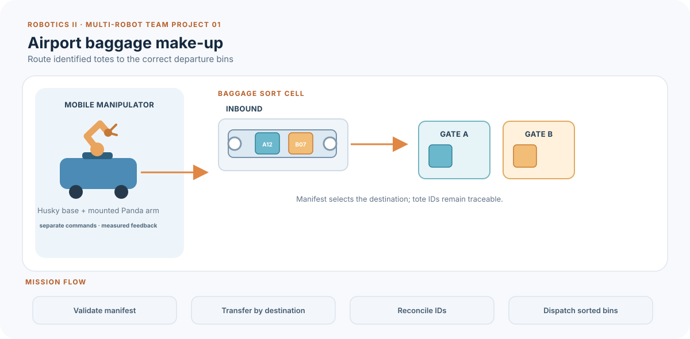
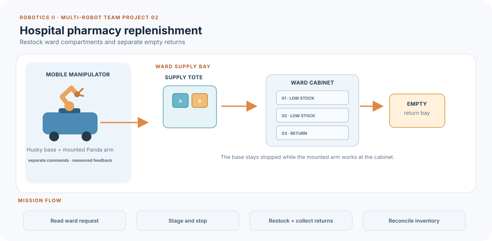
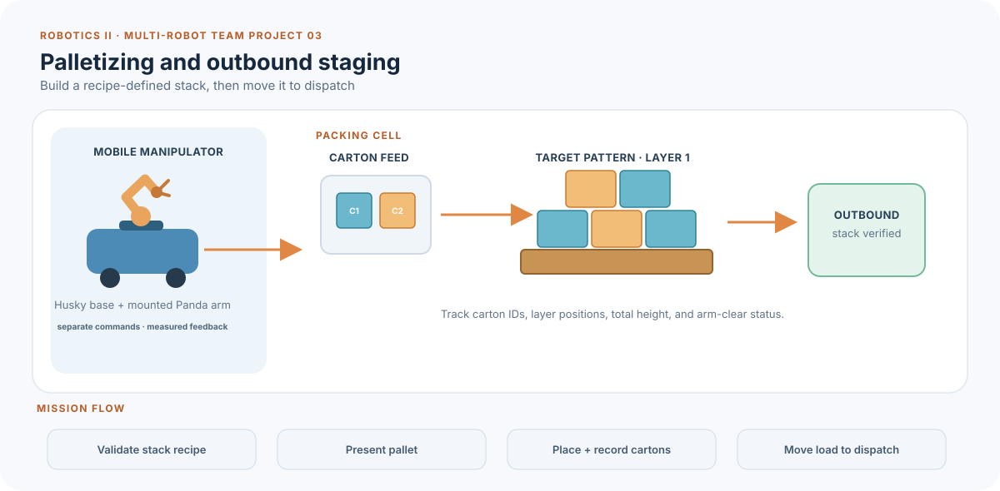
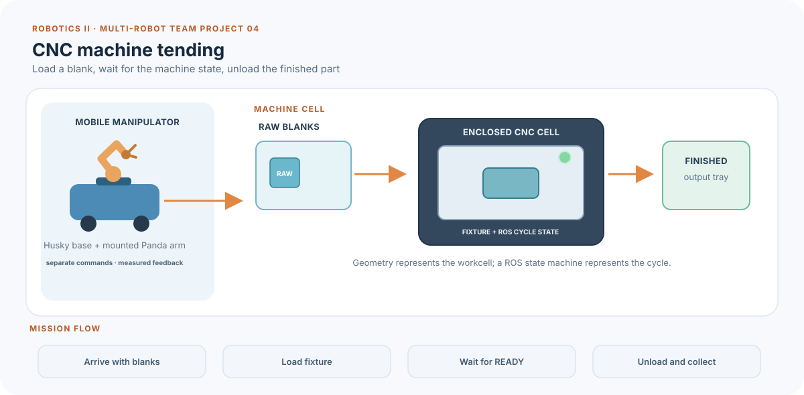
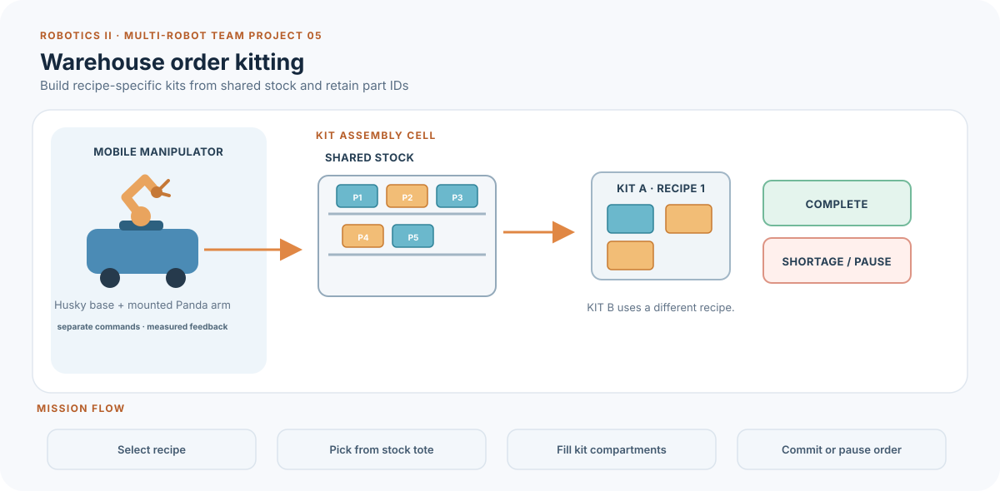
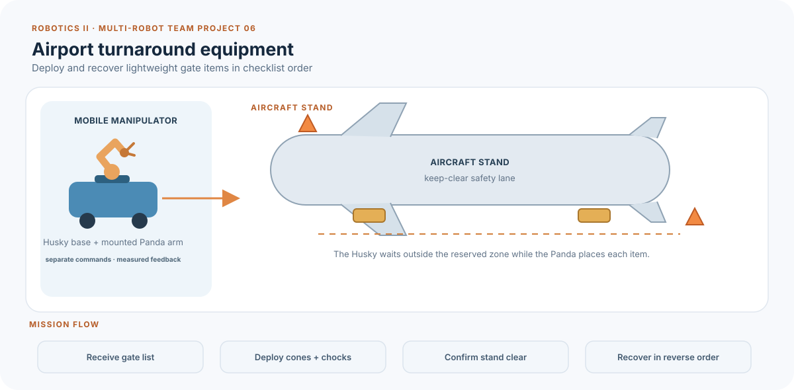
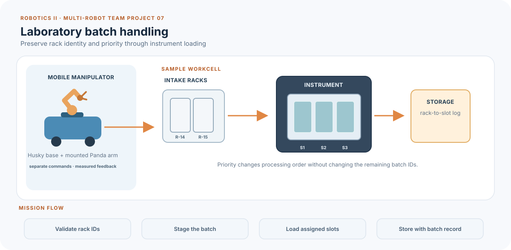

# Sessions 4–6 — multi-robot team projects

Each team of five or six engineers chooses one operational problem and builds
its own SDF environment, ROS 2 mission coordinator, and repeatable evaluation.
Every project uses the Husky mobile manipulator: the Husky base carries a
mounted Panda arm. The base and manipulator are coordinated as two actuated
robot subsystems, with separate commands and measured feedback; together they
form the multi-robot platform for the project.

The seven briefs cover different operating needs. They are starting points,
not completed student solutions. Teams decide the exact layout, mission
states, object flow, safe poses, command policy, and acceptance thresholds.

| # | Application | Main engineering challenge |
| --- | --- | --- |
| 1 | Airport baggage make-up | Assign each bag to a destination and transfer it through the correct sort path. |
| 2 | Hospital pharmacy replenishment | Refill a ward cabinet from a mobile supply tote while keeping the corridor and arm work area coordinated. |
| 3 | Palletizing and outbound staging | Build a specified stack, track its contents, then move the pallet to dispatch. |
| 4 | CNC machine tending | Coordinate loading, machine cycle states, unloading, and a waiting mobile carrier. |
| 5 | Warehouse order kitting | Build different kits from the same parts using order recipes and compartment-level records. |
| 6 | Airport turnaround equipment | Deploy and recover ground-service items in a safe order under a gate-clearance deadline. |
| 7 | Laboratory batch handling | Keep sample-rack identity and order through intake, instrument loading, and storage. |

## The platform and its limits

The repository supplies the mounted Husky-Panda mobile manipulator with
command and measured-feedback paths in one Drake plant. Husky commands use `/husky_runner/cmd_vel`
(`geometry_msgs/msg/Twist`) and measured odometry uses
`/husky_runner/odom` (`nav_msgs/msg/Odometry`). Panda arm targets use
`/panda_inspector/joint_trajectory`
(`trajectory_msgs/msg/JointTrajectory`) and measured joint states use
`/panda_inspector/joint_states` (`sensor_msgs/msg/JointState`). The Panda hand
also accepts a bounded finger-position target on
`/panda_inspector/gripper_position` (`std_msgs/msg/Float64MultiArray`): `0.04`
m opens each finger and `0.0` m closes it. The message contains exactly one
array element, for example `{data: [0.04]}`; an empty or incorrectly sized
array is ignored so startup leaves the fingers at their open default.

The supplied Husky guard limits speed and publishes zero velocity after a
command timeout. The Panda adapter accepts named, finite, in-limit position
targets and holds the last valid target. It does not interpolate
`time_from_start`. The mobile-manipulator exercise demonstrates one small
object transfer; it does not provide Nav2, SLAM, perception, a camera-based
classifier, autonomous collision avoidance, or a general task planner.

Teams create their own scenes by copying an SDF starter into
`models/team_projects/`, then adding their own stations, lanes, shelves,
machines, bins, pallets, markers, and obstacles. Boxes and cylinders are enough
for most collision geometry. A mesh can provide appearance while a simpler
box or cylinder provides collision geometry. Drake's SDF parser supports OBJ
mesh URIs; convert an STL to OBJ before referencing it. Keep the scale in
metres and use a simple collision proxy for reliable contact simulation. See
the [Session 3 mesh tutorial](../session_3_sim_systems/README.md#add-an-obj-mesh-to-an-sdf-scene).

The two-Husky and dual-Panda worlds are parser exercises. Their command and
feedback interfaces are not the supported project baseline. Do not promise
perception, collision avoidance, machine physics, or human-safe operation from
the supplied simulation.

## Seven project briefs

### 1. Airport baggage make-up and exception sorting



At a small baggage make-up cell, an inbound tote arrives with a short manifest
of bag IDs and destination codes. The mobile base brings the tote to the
workcell. The Panda transfers each bag to the matching destination bin; the
Husky then carries the sorted bins to the assigned dispatch marker. Teams can
inject an unknown or duplicate ID to exercise an exception path.

**Subtasks:** receive and validate a manifest; stage the tote and stop at the
workcell; pick and place the listed items; log the destination of each ID;
hold the base when the arm is active; recover safely from an unknown ID or
stale joint feedback.

**SDF work:** model an inbound belt from boxes, two destination bins, a
no-crossing area, and a dispatch bay. Add an OBJ baggage-conveyor shell only
for appearance if the team wants one; use simple collision boxes.

**Evidence:** correct destination for every known ID, no duplicate transfer,
measured arm settling at each placement, stop-timeout behavior, and completion
time over three runs. The manifest supplies the bag code; no vision model is
assumed.

### 2. Hospital pharmacy ward replenishment



A pharmacy prepares a tote for a ward that has several low-stock compartments
and one empty-return compartment. The Husky delivers and positions the tote.
The Panda loads the requested supply units into the right compartments and
places returned empty containers in a separate area. The Husky leaves only
after the cabinet and tote state are reconciled.

**Subtasks:** parse a ward request; reserve the cabinet work area; position
the tote; fill two or three requested compartments; separate returns; publish
the reconciled inventory and return the Husky to the corridor.

**SDF work:** create a corridor, a ward stop zone, a low cabinet, tote bays,
and a keep-clear boundary. Use a mesh for cabinet appearance if useful, with
box collision proxies around shelves and door edges.

**Evidence:** every requested compartment receives the right count, returns
remain separate, measured arrival is within the team's tolerance, and the
Husky never moves while the Panda is outside its safe posture. The request is
provided as ROS data; the scene contains no patient and no clinical sensor.

### 3. Palletizing and outbound staging



A packing cell receives a job describing carton dimensions, IDs, and a target
stack pattern. The Husky brings a pallet or carrier to the cell. The Panda
places a small number of cartons in the specified pattern. After the stack is
complete and the arm is clear, the Husky moves it to the outbound marker.

**Subtasks:** validate a stack recipe; present the pallet; select the next
empty placement; transfer and record each carton; check stack count and
placement tolerance; move the completed load to dispatch. Teams may add a
second layer or one deliberately invalid recipe as an extension.

**SDF work:** define a pallet footprint, cartons with mass and collision
geometry, a loading bay, and an outbound zone. Use simple box collision shapes
even if cartons have detailed OBJ visuals.

**Evidence:** correct IDs and layer positions, final count and stack height,
no Husky departure before arm retraction, one rejected recipe, and three
repeatable completion measurements. A grasp is a physical finger-contact
task; do not replace it with a static attached carton.

### 4. CNC machine tending with a mobile carrier



The Husky transports a tray of raw blanks to a mock CNC cell. The Panda loads
one blank into a marked fixture and retreats. A ROS machine-state node runs a
short simulated cycle. Only a `READY_FOR_UNLOAD` state permits the Panda to
remove the finished blank and place it in the output tray. The Husky collects
the tray after the arm is safe.

**Subtasks:** carrier arrival and stop; door-open/door-closed state handling;
blank loading; simulated machine-cycle wait; unloading and output tracking;
timeout recovery if the machine never reports completion.

**SDF work:** add a machine enclosure, fixture, door swing clearance, input
and output trays, and a marked Husky waiting line. The machine is geometry plus
a ROS state machine; no cutting physics is needed.

**Evidence:** no arm command while the machine is marked busy, no Husky motion
inside the loading zone, correct raw/finished counts, and a safe stopped state
on a missing machine-state update.

### 5. Warehouse order kitting



A warehouse cell receives one of two kit recipes that use the same stock
parts in different combinations. The Husky delivers the stock tote. The Panda
fills numbered kit compartments in recipe order, records part IDs, and places
each completed kit in the ready bay. A shortage or wrong part must pause the
order without corrupting the kit record.

**Subtasks:** select a recipe; reserve a tote; map part IDs to bin locations;
fill and commit one kit; pause on shortage or invalid ID; produce separate
complete and incomplete order records.

**SDF work:** create a stock rack, two kit trays, a mobile staging area, and a
clearance boundary. Students choose the number and placement of bins; starter
geometry does not prescribe a solution.

**Evidence:** both recipes produce the expected contents, invalid input is
rejected, a partial order is not reported complete, the arm's measured joint
state gates the next pick, and three runs preserve the same order records.

### 6. Airport turnaround equipment deployment



Before an aircraft stand is released, a crew must position a defined set of
lightweight service items such as cones and wheel chocks. The Husky brings the
equipment carrier to the stand. The Panda places the items in an order chosen
from the gate checklist. The Husky may leave only after the required set is
deployed and the Panda has returned to its transport posture. Recovery runs
the sequence in reverse before the stand-clear signal.

**Subtasks:** receive a gate checklist and deadline; reserve the stand zone;
deploy items in an allowed order; record each placed item; handle a late
checklist update; recover equipment and publish `STAND_CLEAR`.

**SDF work:** model an aircraft fuselage as a large static box or OBJ visual,
with a simple collision proxy, plus wheel outlines, safety lanes, and item
markers. Do not model aircraft aerodynamics or people.

**Evidence:** checklist completeness, no movement through a reserved zone,
arm-safe interlock before travel, correct reverse recovery, and response to a
deadline or stale-feedback event.

### 7. Laboratory batch and sample-rack handling



An intake station issues a batch containing rack IDs and instrument
destinations. The Husky carries the batch to an instrument area. The Panda
loads each rack into the assigned slot, then returns the empty transport tray
to the Husky. The batch record follows each rack through instrument loading
and final storage; a priority rack is processed first without reordering the
remaining IDs.

**Subtasks:** validate batch IDs; select the priority rack; stop and stage the
Husky; load the assigned instrument slots; preserve the rack-to-slot record;
transport completed racks to storage; reject a duplicate or unknown ID.

**SDF work:** make an intake bench, instrument face with numbered slots,
storage rack, and a corridor route. Use lightweight box racks for manipulation
and simple machine geometry for the instrument.

**Evidence:** every rack reaches its assigned slot, the priority order is
honored, no rack is silently dropped from the record, the base waits during
arm work, and duplicates are rejected with a recoverable error state.

## Work across Sessions 4–6

Create a team-specific copy of the mounted mobile-manipulator scene, then
replace or extend its workcell geometry for the chosen scenario. Keep the SDF
inside `models/team_projects/` and retain the instance names
`husky_runner` and `panda_inspector`:

```bash
cp models/team_projects/husky_panda_pick_place.sdf \
  models/team_projects/team_01_world.sdf
python3 exercises/session_3/check_project_world.py team_01_world.sdf
```

The scene checker verifies that the Husky base and mounted Panda arm parse into
one Drake plant. It does not validate the team's controller, layout, route, or
grasp behavior.

| Session | Team deliverable |
| --- | --- |
| **4 — Build the scene and interfaces** | Create an SDF copy, name both robot instances, add the work zones and objects, launch the supplied platform, and record one command and measured response from each robot. |
| **5 — Coordinate the mission** | Implement the state machine, task-specific ROS messages or parameters, measured transition conditions, safe arm/base interlocks, timeout behavior, and one recovery path. |
| **6 — Measure and demonstrate** | Run three repeatable trials, inject a fault, report task metrics, show the ROS graph, explain each SDF asset, and demonstrate the complete workflow. |

Five or six owners can split scene creation, Husky movement, Panda/gripper
motion, mission-state logic, ROS integration, and tests/metrics. Each student
must own a reviewable contribution and explain how its measured result was
checked. Students can combine roles if the group is smaller.

## Minimum ROS 2 and SDF requirements

Every team must:

- include the Husky mobile base and mounted Panda arm in one Drake plant;
- create at least two team-owned subscriptions, including measured Husky
  odometry and Panda joint feedback;
- create two team-owned command publishers for the Husky base and Panda arm;
- use both base and arm meaningfully in the task, with an arm-safe interlock
  before base motion;
- implement at least one ROS 2 mission-coordinator node with named states,
  measured state transitions, a timeout, and a defined safe response;
- build or modify its own SDF environment and include the final SDF in its
  submission;
- show the nodes and topics in `rqt_graph` and document message types, units,
  frames, and command/feedback owners;
- report at least one numeric task metric over three runs and one deliberate
  failure or timeout test.

The Husky's velocity is in m/s and rad/s in the world-aligned ground plane.
Panda arm positions are in radians; gripper finger positions are in metres.
Teams must confirm their chosen frames and thresholds in the actual launch.
The provided SDF parser check confirms that the expected model instances load
into one finalized plant. It does not prove that a controller, grasp, route, or
mission works.

The optional [project README template](../../exercises/projects/project_readme_template.md)
can help teams plan their submission. It is not an additional required report.
