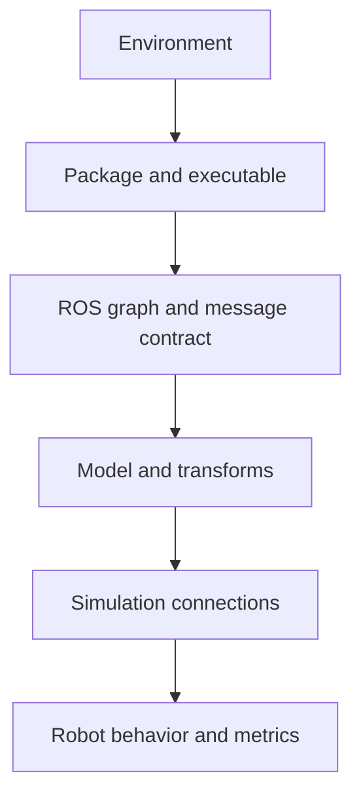

# A repeatable debugging method

Robot software fails across several layers. Guessing at the visual symptom is
slow; locate the first broken layer.

For each layer, ask one testable question:

1. **Environment:** do `course_check.sh` and Python imports pass?
2. **Build:** does `ros2 pkg prefix PACKAGE` find the overlay?
3. **Graph:** are the expected nodes, topics, types and publishers present?
4. **Description:** is the XML valid and is the TF tree connected?
5. **Simulation:** are all Drake input ports connected and was the plant
   finalized only after loading/welding models?
6. **Behavior:** is the command valid, is feedback changing, and what numeric
   error or rate proves it?

Record the exact command, first error line, expected result and actual result.
Change one thing, rerun the smallest failing check, then commit the repair. A
screenshot alone is not enough evidence for a dynamic behavior; include a topic
sample, plot or numerical metric.

