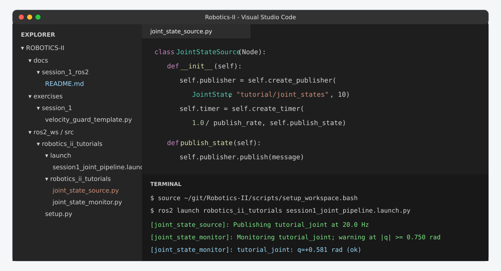
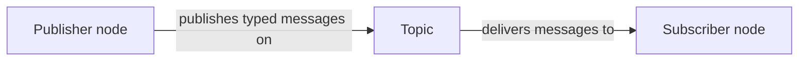
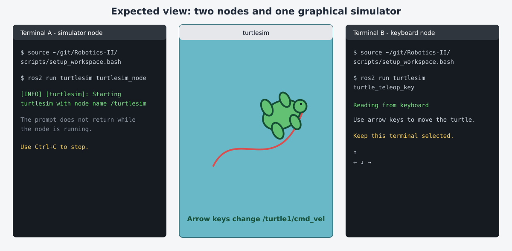
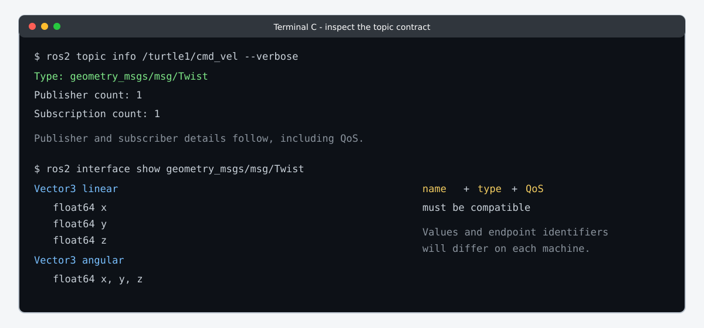
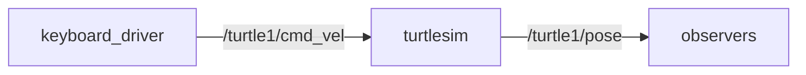
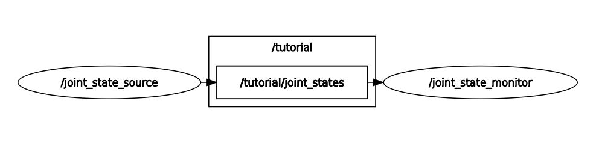
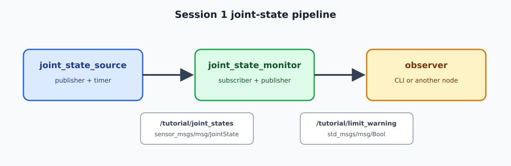
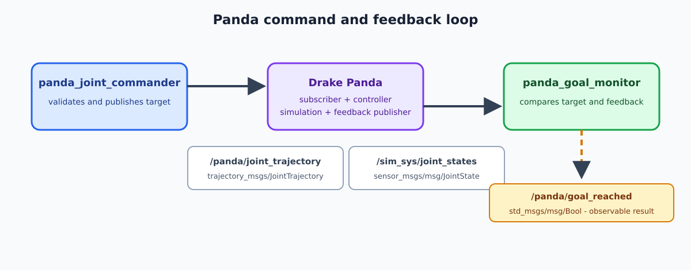
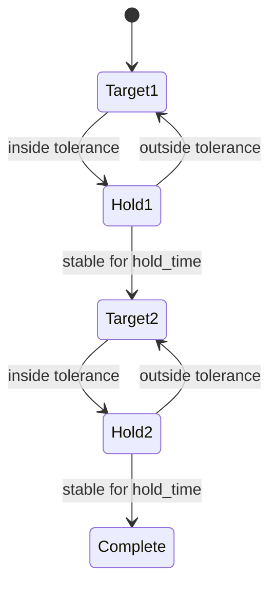
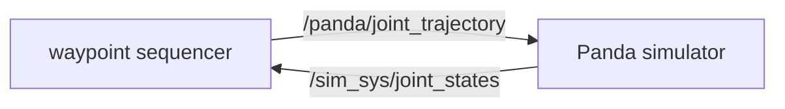

# Session 1 - ROS 2 foundations for robot software
This session introduces ROS 2 as the communication layer of a robot. You will first investigate a small running system with `turtlesim`, then read and modify Python publisher/subscriber nodes, configure them with parameters and launch files, and finally apply the same ideas to a simulated Panda robot.

The tutorial is self-contained. The official ROS 2 pages linked throughout the text are references: use them for another explanation or for further study, but you do not need to complete a second tutorial in parallel.

## Learning outcomes
At the end of the session, you should be able to:

- distinguish a workspace, package, executable and node;
- discover an unfamiliar ROS graph before reading its source code;
- identify the publishers, subscribers, message type and QoS of a topic;
- explain the purpose of `rclpy.init`, `Node`, callbacks and `rclpy.spin`;
- modify a Python publisher and complete a subscriber;
- configure nodes with parameters, YAML, remapping and a Python launch file;
- connect a command node to simulated Panda feedback;
- implement a two-waypoint Panda sequence driven by measured joint feedback;
- demonstrate correct behavior using command-line and graph evidence.

## 0. Prepare your working environment
### 0.1 Open the repository in VS Code
The recommended editor is Visual Studio Code. If it is not installed yet, follow the [Visual Studio Code setup instructions](../00_setup.md#install-visual-studio-code) before continuing. When using WSL2, VS Code must be installed on Windows with the Microsoft WSL extension, not as a second full installation inside Ubuntu. From an Ubuntu or WSL terminal:

Run each command separately:

```bash
cd ~/git/Robotics-II
```

```bash
code .
```

On WSL2, check the lower-left corner of the VS Code window. It should indicate that the folder is connected to WSL. The integrated terminals must show a Linux prompt and the repository path should be under `/home`, not `/mnt/c`. If `code` is not available, you may use another editor. A terminal-only option is `nano`:

```bash
nano ~/git/Robotics-II/ros2_ws/src/robotics_ii_tutorials/setup.py
```

In `nano`, use `Ctrl+O`, then `Enter`, to save and `Ctrl+X` to exit.



Keep the Explorer visible on the left and open at least two terminals. Robot software is distributed: one terminal often runs the system while another terminal inspects or commands it.

### 0.2 Source and verify the course environment
Every new terminal starts without knowledge of the packages built in this repository. Run the following command in **every new terminal**:

```bash
source ~/git/Robotics-II/scripts/setup_workspace.bash
```

Now verify the installation:

After the prompt returns, run the verification command:

```bash
~/git/Robotics-II/scripts/course_check.sh
```

Each check prints a `PASS` line. The final line reads **Environment ready for Robotics II.**

If a check fails, use [setup and recovery](../00_setup.md) before continuing. Do not debug tutorial code while the underlying environment is unknown.

### 0.3 Terminal conventions
This page uses **Terminal A**, **Terminal B**, and sometimes **Terminal C**. They are separate terminal windows or VS Code terminal tabs.

- A command keeps running when the terminal does not return to the prompt.
- Stop a running ROS node with `Ctrl+C`.
- Do not close Terminal A merely because Terminal B needs another command.
- Commands such as `ros2 topic echo --no-daemon` and `ros2 topic hz` continue until `Ctrl+C`, unless `--once` is used.
- For this course, add `--no-daemon` to node/topic graph inspection commands: `ros2 node list`, `ros2 node info`, `ros2 topic list`, `ros2 topic info`, and `ros2 topic echo`. The examples below show the exact placement. `ros2 topic hz` and `ros2 topic bw` do not accept this option.

Run commands one at a time unless the text explicitly says that several lines form one shell command.

- Source the workspace again whenever you open a new terminal.

## 1. Build a mental model of ROS 2
A robot application is rarely one large program. Perception, control, planning, hardware access and visualization normally run as separate processes. ROS 2 lets these processes discover each other and exchange typed data.

### 1.1 Four layers you will use
| Layer | Example in this repository | Meaning |
| --- | --- | --- |
| Workspace | `ros2_ws` | A directory in which a related set of packages is built. |
| Package | `robotics_ii_tutorials` | A unit of dependencies, installation and sharing. |
| Executable | `joint_state_source` | An installed program that `ros2 run` can start. |
| Node | `/joint_state_source` | A running participant registered in the ROS graph. |

The distinction between executable and node is important. A Python file is not a node while it is sitting on disk. It becomes a running node after a process starts it and the code creates a `Node`. The same executable can be started several times with different node names or namespaces.

### 1.2 The ROS graph
The ROS graph is the network of running nodes and their communication endpoints. The most important mechanisms are:

| Mechanism | Communication pattern | Typical robot use |
| --- | --- | --- |
| Topic | Continuous, asynchronous stream | Sensors, joint state, velocity commands |
| Service | One request and one response | Reset or short query |
| Action | Long-running goal with feedback and cancellation | Navigation or a timed trajectory |
| Parameter | Configuration attached to a node | Gains, rates, thresholds and frame names |

Topics are the main mechanism in this session. Services and actions are shown only so that you can recognize them when inspecting a node.

### 1.3 Nodes, topics, publishers and subscribers

A node is a running ROS 2 process. A publisher sends typed messages on a topic, and a subscriber receives messages from that topic. One node can publish and subscribe at the same time.



In the exercises, `/tutorial/joint_states` is the topic, `joint_state_source` is the publisher and `joint_state_monitor` is a subscriber. The same topic can have several subscribers, which is why a velocity guard can observe the same feedback without modifying the source. For the official terminology and command examples, see the [ROS 2 nodes tutorial](https://docs.ros.org/en/jazzy/Tutorials/Beginner-CLI-Tools/Understanding-ROS2-Nodes/Understanding-ROS2-Nodes.html), [ROS 2 topics tutorial](https://docs.ros.org/en/jazzy/Tutorials/Beginner-CLI-Tools/Understanding-ROS2-Topics/Understanding-ROS2-Topics.html) and [Writing a simple ROS 2 publisher and subscriber](https://docs.ros.org/en/jazzy/Tutorials/Beginner-Client-Libraries/Writing-A-Simple-Py-Publisher-And-Subscriber.html).

## 2. Discover ROS 2 with turtlesim
`turtlesim` is deliberately small. It lets you investigate a real ROS graph without also dealing with robot dynamics, URDF files or controllers.

### 2.1 Start two nodes
In Terminal A:

Run each command separately:

```bash
source ~/git/Robotics-II/scripts/setup_workspace.bash
```

```bash
ros2 run turtlesim turtlesim_node
```

A graphical window should open. Terminal A remains occupied because the node is running.

In Terminal B:

Run each command separately:

```bash
source ~/git/Robotics-II/scripts/setup_workspace.bash
```

```bash
ros2 run turtlesim turtle_teleop_key
```

Keep Terminal B selected and use the arrow keys. The turtle should move in the graphical window.



The two executables are different, but their nodes belong to the same ROS graph. The keyboard node publishes commands and the simulator subscribes to them.

### 2.2 Discover nodes before reading code
Open Terminal C and source the environment. Then list the nodes:

Run each command separately:

```bash
source ~/git/Robotics-II/scripts/setup_workspace.bash
```

```bash
ros2 node list --no-daemon
```

Expected application nodes:

```text
/teleop_turtle
/turtlesim
```

Inspect the simulator:

```bash
ros2 node info --no-daemon /turtlesim
```

Do not try to memorize the complete output. Identify these categories:

- **Subscribers**: topics received by the node;
- **Publishers**: topics sent by the node;
- **Service servers/clients**: request-response endpoints;
- **Action servers/clients**: long-running goal endpoints.

Answer before continuing:

1. Which topic carries motion commands to the turtle?
2. Which topic reports the turtle pose?
3. Is `/turtlesim` a publisher, subscriber, or both?

#### Check that an executable name is not a node name
Stop only Terminal B with `Ctrl+C`, then restart the same executable with a different node name:

```bash
ros2 run turtlesim turtle_teleop_key --ros-args \
  -r __node:=keyboard_driver
```

In Terminal C:

Run each command separately:

```bash
ros2 node list --no-daemon
```

```bash
ros2 node info --no-daemon /keyboard_driver
```

`/teleop_turtle` has disappeared and `/keyboard_driver` has taken its place, but the executable is still `turtle_teleop_key`. This small experiment separates three ideas that are often confused:

- the executable is selected before `--ros-args`;
- the node is the running ROS participant;
- remapping can change the graph name without modifying source code.

Keep the renamed keyboard node running for the topic exercises below. The official [ROS 2 nodes tutorial](https://docs.ros.org/en/jazzy/Tutorials/Beginner-CLI-Tools/Understanding-ROS2-Nodes/Understanding-ROS2-Nodes.html) contains another guided explanation of these commands.

### 2.3 Inspect topics and message contracts
List topic names together with their types:

```bash
ros2 topic list --no-daemon -t
```

Focus on these two topics:

```text
/turtle1/cmd_vel [geometry_msgs/msg/Twist]
/turtle1/pose [turtlesim/msg/Pose]
```

Inspect the command topic:

Run each command separately:

```bash
ros2 topic info --no-daemon /turtle1/cmd_vel --verbose
```

```bash
ros2 interface show geometry_msgs/msg/Twist
```

`Twist` contains two three-dimensional vectors:

```text
geometry_msgs/Vector3 linear
geometry_msgs/Vector3 angular
```

For this planar example, `linear.x` moves forward and `angular.z` turns. The remaining components stay zero.

Publish one command without using the keyboard:

```bash
ros2 topic pub --once /turtle1/cmd_vel geometry_msgs/msg/Twist \
  "{linear: {x: 1.0}, angular: {z: 0.5}}"
```

Now publish repeatedly at 2 Hz:

```bash
ros2 topic pub --rate 2 /turtle1/cmd_vel geometry_msgs/msg/Twist \
  "{linear: {x: 1.0}, angular: {z: 0.5}}"
```

Stop it with `Ctrl+C`. Explain why `--once` produces only a short motion while `--rate 2` keeps the turtle moving.

In another terminal, inspect the output state:

Run each command separately:

```bash
ros2 topic echo --no-daemon /turtle1/pose --once
```

```bash
ros2 topic hz /turtle1/pose
```

The numerical values and rate will vary. Stop `ros2 topic hz` with `Ctrl+C` after several measurements.



A topic connection requires compatible:

1. topic names;
2. message types;
3. Quality of Service (QoS) settings.

A topic name alone is not a data contract. The type defines the available fields; the application still defines the units, frame conventions and meaning of those fields.

The number `10` used later in `create_publisher(..., 10)` and `create_subscription(..., 10)` is a queue depth, not a publication frequency. With the default keep-last policy, an endpoint can retain up to ten samples that have not yet been processed. QoS also controls properties such as reliability and durability. Reliable delivery is appropriate for the small local command/feedback examples in this session. High-rate sensors sometimes use best-effort delivery to prioritize recent samples. When two correctly named endpoints do not exchange data, `ros2 topic info --no-daemon /topic_name --verbose` is therefore more informative than `ros2 topic list --no-daemon` alone.

The official [ROS 2 topics tutorial](https://docs.ros.org/en/jazzy/Tutorials/Beginner-CLI-Tools/Understanding-ROS2-Topics/Understanding-ROS2-Topics.html) can be used if you want more examples of `list`, `info`, `echo`, `pub` and `hz`.

### 2.4 Visualize the graph
With both turtlesim nodes still running:

```bash
rqt_graph
```

If that command is unavailable, use:

```bash
ros2 run rqt_graph rqt_graph
```

Select **Nodes/Topics (all)** if the graph is too simplified. You should be able to follow this application-level connection:



Your command-line inspection and `rqt_graph` show the same graph in different forms. The command line is more precise for types and QoS; the graphical view is useful for understanding a larger system.

Stop Terminal A and Terminal B with `Ctrl+C` before continuing.

## 3. Inspect the course workspace and package
Move from the generic demonstration to the package supplied for Robotics II: Run each command separately:

```bash
cd ~/git/Robotics-II/ros2_ws
```

```bash
colcon list
```

```bash
ros2 pkg executables robotics_ii_tutorials
```

```bash
ros2 pkg prefix robotics_ii_tutorials
```

You should find four executables:

```text
robotics_ii_tutorials joint_state_monitor
robotics_ii_tutorials joint_state_source
robotics_ii_tutorials panda_goal_monitor
robotics_ii_tutorials panda_joint_commander
```

The package contains several different file types:

```text
robotics_ii_tutorials/
├── config/                       YAML parameter files
├── launch/                       Python launch files
├── robotics_ii_tutorials/        Python modules
├── package.xml                   ROS dependencies and metadata
├── setup.cfg                     installation configuration
└── setup.py                      Python package and executable entry points
```

Open the package in VS Code:

Run each command separately:

```bash
cd ~/git/Robotics-II/ros2_ws/src/robotics_ii_tutorials
```

```bash
code .
```

Or open only `setup.py` in a terminal editor:

```bash
nano ~/git/Robotics-II/ros2_ws/src/robotics_ii_tutorials/setup.py
```

Find `entry_points` near the bottom:

```python
"joint_state_source = robotics_ii_tutorials.joint_state_source:main"
```

Interpret it from left to right:

- `joint_state_source` is the executable name used by `ros2 run`;
- `robotics_ii_tutorials.joint_state_source` is the Python module;
- `main` is the function called when the executable starts.

This is why creating a Python file alone does not make it available through `ros2 run`. The module must also be installed and registered as an entry point.

## 4. Investigate the course publisher/subscriber pipeline
### 4.1 Launch the complete graph
In Terminal A:

```bash
source ~/git/Robotics-II/scripts/setup_workspace.bash
```

After the prompt returns, start the graph:

```bash
ros2 launch robotics_ii_tutorials session1_joint_pipeline.launch.py
```

You should see messages similar to:

```text
[joint_state_source]: Publishing tutorial_joint at 20.0 Hz; amplitude and frequency can be changed while running.
[joint_state_monitor]: Monitoring tutorial_joint; warning at |q| >= 0.750 rad
[joint_state_monitor]: tutorial_joint: q=+0.58 rad (ok)
```

The timestamps and joint positions will differ. Terminal A must remain running.

In Terminal B, run the commands below one at a time. Source the workspace first:

```bash
source ~/git/Robotics-II/scripts/setup_workspace.bash
```

List the running nodes:

```bash
ros2 node list --no-daemon
```

The list should contain `/joint_state_source` and `/joint_state_monitor`.

List topics together with their message types:

```bash
ros2 topic list --no-daemon -t
```

Look for `/tutorial/joint_states`, `/tutorial/limit_warning` and the parameter/event topics.

Inspect the source endpoints:

```bash
ros2 node info --no-daemon /joint_state_source
```

Inspect the monitor endpoints:

```bash
ros2 node info --no-daemon /joint_state_monitor
```

Finally, open the visual graph:

```bash
rqt_graph
```

The graph should show the source publishing `/tutorial/joint_states` to the monitor.

Expected `rqt_graph` view:



The simplified application graph is:



The source node generates a synthetic joint state. The monitor receives that state, extracts one named joint and publishes a Boolean warning. ROS also creates logging and parameter endpoints, so `ros2 topic list --no-daemon` contains more than the two application topics in the figure.

### 4.2 Inspect the JointState message
Run the commands one at a time.

First inspect the topic endpoints:

```bash
ros2 topic info --no-daemon /tutorial/joint_states --verbose
```

The output should identify the publisher, subscriber, message type and QoS. Then inspect the message definition:

```bash
ros2 interface show sensor_msgs/msg/JointState
```

It should list `header`, `name`, `position`, `velocity` and `effort`. Finally read one sample:

```bash
ros2 topic echo --no-daemon /tutorial/joint_states --once
```

The sample should contain the joint name and finite numeric position and velocity fields. A sample has the following structure:

```yaml
header:
  stamp:
    sec: 12
    nanosec: 345000000
name:
- tutorial_joint
position:
- 0.62
velocity:
- 0.49
effort:
- 0.0
```

The values will differ. Important observations:

- `name`, `position`, `velocity` and `effort` are arrays;
- array elements are associated by index;
- positions are in radians and velocities in radians per second here;
- robust consumer code selects a value by joint name rather than assuming the producer always uses a particular array order.

Measure the publication rate:

```bash
ros2 topic hz /tutorial/joint_states
```

Wait for several estimates, then stop with `Ctrl+C`. A result close to 20 Hz is expected, but an operating system does not guarantee exactly `20.000 Hz`. Observe the warning:

```bash
ros2 topic echo --no-daemon /tutorial/limit_warning
```

You should see both `data: false` and `data: true` because the sinusoidal joint crosses the configured threshold. Stop with `Ctrl+C`.

### 4.3 Diagnose a graph problem methodically
If a subscriber exists but no messages arrive, inspect in this order:

1. Is the publisher node running?
2. Does the expected topic name exist?
3. Does `ros2 topic info --no-daemon /tutorial/joint_states --verbose` show both endpoints?
4. Do publisher and subscriber use the same message type?
5. Are their QoS settings compatible?
6. Is the callback rejecting the messages because fields are malformed?

Do not immediately change source code. First establish which contract is broken.

## 5. Read and modify a Python publisher
Open the source:

```bash
code ~/git/Robotics-II/ros2_ws/src/robotics_ii_tutorials/robotics_ii_tutorials/joint_state_source.py
```

Terminal-only alternative:

```bash
nano ~/git/Robotics-II/ros2_ws/src/robotics_ii_tutorials/robotics_ii_tutorials/joint_state_source.py
```

### 5.1 Imports and node class
The important imports are:

```python
import rclpy
from rclpy.node import Node
from sensor_msgs.msg import JointState
```

`rclpy` is the Python client library for ROS 2. `Node` provides publishers, subscriptions, timers, parameters and logging. `JointState` is the message class used for the output.

The class inherits from `Node`:

```python
class JointStateSource(Node):
    def __init__(self):
        super().__init__("joint_state_source")
```

The name passed to `Node` becomes the default graph name.

### 5.2 Parameters replace hard-coded configuration
The source declares four parameters:

```python
self.declare_parameter("joint_name", "tutorial_joint")
self.declare_parameter("amplitude", 1.0)
self.declare_parameter("frequency", 0.10)
self.declare_parameter("publish_rate", 20.0)
```

Declaring a parameter gives it a name, type and default value. The code must still read and use that value; declaration alone does not change behavior.

### 5.3 Publisher and timer
The publisher is created with:

```python
self.publisher = self.create_publisher(
    JointState,
    "tutorial/joint_states",
    10,
)
```

The arguments specify the message type, relative topic name and queue depth. The relative name becomes `/tutorial/joint_states` when the node has no namespace.

The timer schedules the callback:

```python
self.timer = self.create_timer(1.0 / publish_rate, self.publish_state)
```

The timer period is the inverse of the desired publication rate.

### 5.4 Message construction
The callback evaluates

$$

q(t)=A\sin(2\pi f t), \qquad

\dot q(t)=2\pi fA\cos(2\pi f t).

$$

It then constructs and publishes the message:

```python
message = JointState()
message.header.stamp = self.get_clock().now().to_msg()
message.name = [self.joint_name]
message.position = [self.amplitude * math.sin(omega * elapsed)]
message.velocity = [self.amplitude * omega * math.cos(omega * elapsed)]
message.effort = [0.0]
self.publisher.publish(message)
```

The timestamp tells downstream nodes when the sample was produced. The square brackets are required because the JointState fields are arrays, even though this example contains only one joint.

Prediction questions:

1. What is the maximum absolute position?
2. What is the maximum absolute velocity?
3. When the position is at its positive maximum, what should the velocity be?
4. If frequency doubles while amplitude stays constant, which maxima change?

Check one `ros2 topic echo --no-daemon` sample against the slope visible in successive position samples.

### 5.5 Node lifecycle
At the bottom of the file:

```python
rclpy.init(args=args)
node = JointStateSource()
rclpy.spin(node)
node.destroy_node()
rclpy.shutdown()
```

`rclpy.init` initializes the ROS context. `spin` keeps the process alive and lets the executor call timers and communication callbacks. Cleanup destroys the node and shuts down the context.

The official [Python publisher/subscriber tutorial](https://docs.ros.org/en/jazzy/Tutorials/Beginner-Client-Libraries/Writing-A-Simple-Py-Publisher-And-Subscriber.html) uses a text message instead of joint feedback. The program structure is the same.

### 5.6 Make and verify a controlled change
Change `message.effort` from zero to a finite value of your choice. Do not change the topic name or message type.

Build and source:

Run each command separately:

```bash
cd ~/git/Robotics-II/ros2_ws
```

```bash
colcon build --symlink-install --packages-select robotics_ii_tutorials
```

```bash
source ~/git/Robotics-II/scripts/setup_workspace.bash
```

Restart the launch in Terminal A and inspect one message in Terminal B:

```bash
ros2 topic echo --no-daemon /tutorial/joint_states --once
```

Point to the field that proves your edited source is running. Then restore the line to:

```python
message.effort = [0.0]
```

If your edit is not visible, confirm that you edited the source under `~/git/Robotics-II`, rebuilt the correct package and sourced the resulting `install/setup.bash` in the terminal used to launch the node.

## 6. Read a subscriber and complete one yourself
Open:

```bash
code ~/git/Robotics-II/ros2_ws/src/robotics_ii_tutorials/robotics_ii_tutorials/joint_state_monitor.py
```

The subscription is created with:

```python
self.subscription = self.create_subscription(
    JointState,
    "tutorial/joint_states",
    self.receive_state,
    10,
)
```

Each compatible incoming message schedules `receive_state`. That callback:

1. rejects inconsistent `name` and `position` array lengths;
2. creates a dictionary with `dict(zip(message.name, message.position))`;
3. selects the configured joint by name;
4. rejects non-finite data;
5. evaluates the warning condition;
6. publishes a `std_msgs/msg/Bool` result.

This pattern appears repeatedly in robot software:

```text
receive feedback -> validate -> select by identity -> calculate -> publish
```

### 6.1 Complete the velocity guard
The starter file is:

```text
exercises/session_1/velocity_guard_template.py
```

Copy it into the Python package:

```bash
cp ~/git/Robotics-II/exercises/session_1/velocity_guard_template.py \
  ~/git/Robotics-II/ros2_ws/src/robotics_ii_tutorials/robotics_ii_tutorials/velocity_guard.py
```

Open the copied file and replace every `TODO`. The new node must:

- subscribe to `tutorial/joint_states` as `JointState`;
- publish `tutorial/velocity_warning` as `Bool`;
- declare `joint_name`, defaulting to `tutorial_joint`;
- declare a positive `velocity_limit`, defaulting to `0.5` rad/s;
- compare `abs(velocity)` with the limit;
- reject malformed, missing or non-finite values.

Do not modify `joint_state_source.py` to solve this exercise.

Useful construction pattern:

```python
warning = Bool()
warning.data = abs(velocity) >= self.velocity_limit
self.warning_publisher.publish(warning)
```

### 6.2 Register the executable
Add the following entry to the `console_scripts` list in `setup.py`:

```python
"velocity_guard = robotics_ii_tutorials.velocity_guard:main",
```

Rebuild and source because an entry point changed:

Run each command separately:

```bash
cd ~/git/Robotics-II/ros2_ws
```

```bash
colcon build --symlink-install --packages-select robotics_ii_tutorials
```

```bash
source ../scripts/setup_workspace.bash
```

```bash
ros2 pkg executables robotics_ii_tutorials
```

The last command must now list `velocity_guard`.

### 6.3 Test the node before changing the launch file
Keep `session1_joint_pipeline.launch.py` running in Terminal A. Start your new node separately in Terminal B:

```bash
ros2 run robotics_ii_tutorials velocity_guard --ros-args \
  -p velocity_limit:=0.5
```

In Terminal C:

Run each command separately:

```bash
ros2 node info --no-daemon /velocity_guard
```

```bash
ros2 topic info --no-daemon /tutorial/velocity_warning --verbose
```

```bash
ros2 topic echo --no-daemon /tutorial/velocity_warning
```

You should observe both `true` and `false`. If the output never changes, compare the configured limit with the theoretical maximum velocity `2*pi*frequency*amplitude`.

### 6.4 Add it to the launch graph
Open `launch/session1_joint_pipeline.launch.py`. Add a third `Node` action, using the same namespace and YAML configuration as the existing nodes:

```python
Node(
    package="robotics_ii_tutorials",
    executable="velocity_guard",
    name="velocity_guard",
    namespace=namespace,
    parameters=[default_config],
    output="screen",
),
```

Add this parameter to `config/session1.yaml`:

```yaml
velocity_limit: 0.5
```

Rebuild, restart the launch and verify that all three nodes now start together. The complete requirements and evidence are summarized in the [Session 1 exercise](../../exercises/session_1/README.md).

## 7. Configure nodes with parameters and YAML
Parameters configure a node without changing its algorithm. With the joint pipeline launch running, inspect the source parameters:

Run each command separately:

```bash
ros2 param list /joint_state_source
```

```bash
ros2 param describe /joint_state_source amplitude
```

```bash
ros2 param get /joint_state_source amplitude
```

Change valid parameters while the node runs:

Run each command separately:

```bash
ros2 param set /joint_state_source amplitude 0.5
```

```bash
ros2 param set /joint_state_source frequency 0.25
```

Observe `/tutorial/joint_states` and the two warning topics. Relate the changed behavior to the equations in Section 5.

Now try an invalid change:

```bash
ros2 param set /joint_state_source amplitude -2.0
```

The request should fail and the previous amplitude should remain active:

```bash
ros2 param get /joint_state_source amplitude
```

The node validates proposed values in `update_parameters`. It accepts valid live changes to amplitude and frequency. It rejects live changes to `joint_name` and `publish_rate` because changing them would require recreating an endpoint or timer.

### 7.1 Load startup values from YAML
Open:

```bash
code ~/git/Robotics-II/ros2_ws/src/robotics_ii_tutorials/config/session1.yaml
```

The file uses the standard ROS 2 parameter structure:

```yaml
/**:
  ros__parameters:
    joint_name: tutorial_joint
    amplitude: 1.0
    frequency: 0.10
    publish_rate: 20.0
    warning_position: 0.75
    report_period: 1.0
    velocity_limit: 0.5
```

The first two YAML levels have precise roles:

- `/**` is a wildcard node selector: the following overrides are offered to every node started with this file;

- `ros__parameters` marks the mapping that contains ROS parameters;
- each node uses only parameters that it explicitly declares. The source uses `amplitude`, `frequency` and `publish_rate`, while the position monitor uses `warning_position` and `report_period`. An unrelated key is ignored by that node.

For example, `warning_position` does not change the sine trajectory. It changes only the threshold used by `joint_state_monitor`. Lowering the threshold makes the warning true for a longer part of each period; raising it makes the warning true for a shorter part. A value above the trajectory amplitude means it never becomes true.

Change `warning_position`, rebuild, restart and predict the effect before observing it. The rebuild installs the modified YAML file. The restart is required because this YAML file supplies startup overrides; the monitor reads `warning_position` when its process is created and does not implement a live parameter-update callback for that value.

Run each command separately:

```bash
cd ~/git/Robotics-II/ros2_ws
```

```bash
colcon build --symlink-install --packages-select robotics_ii_tutorials
```

```bash
source ../scripts/setup_workspace.bash
```

```bash
ros2 launch robotics_ii_tutorials session1_joint_pipeline.launch.py
```

Questions:

1. Does the source trajectory change?
2. Does the warning remain true for a longer or shorter part of each period?
3. Why is a restart required for this monitor parameter?

The official [ROS 2 parameters tutorial](https://docs.ros.org/en/jazzy/Tutorials/Beginner-CLI-Tools/Understanding-ROS2-Parameters/Understanding-ROS2-Parameters.html) provides additional command-line examples.

## 8. Launch files, namespaces and remapping
A launch file describes a reproducible process graph: which executable to start, its node name, namespace, parameters, arguments and output policy. The algorithm itself remains in the node source.

Open:

```bash
code ~/git/Robotics-II/ros2_ws/src/robotics_ii_tutorials/launch/session1_joint_pipeline.launch.py
```

Find these elements:

- `LaunchDescription`, which contains the actions;
- `DeclareLaunchArgument`, which exposes configurable launch input;
- `LaunchConfiguration`, which refers to that input;
- one `Node` action per executable;
- `parameters=[default_config]`, which loads the YAML file.

Display the declared arguments:

```bash
ros2 launch robotics_ii_tutorials session1_joint_pipeline.launch.py --show-args
```

### 8.1 Namespaces allow reusable graphs
Stop the existing launch. Start two copies in separate terminals:

In Terminal A:

```bash
ros2 launch robotics_ii_tutorials session1_joint_pipeline.launch.py \
  namespace:=robot_a
```

In Terminal B:

```bash
ros2 launch robotics_ii_tutorials session1_joint_pipeline.launch.py \
  namespace:=robot_b
```

In Terminal C:

Run each command separately:

```bash
ros2 node list --no-daemon
```

```bash
ros2 topic list --no-daemon -t | grep -E 'robot_a|robot_b'
```

Expected naming pattern:

```text
/robot_a/joint_state_source
/robot_a/tutorial/joint_states
/robot_b/joint_state_source
/robot_b/tutorial/joint_states
```

The same source code and launch file now produce two independent graphs.

### 8.2 Remapping rewires names at startup
Stop both launch files. In Terminal A:

```bash
ros2 run robotics_ii_tutorials joint_state_source --ros-args \
  -r tutorial/joint_states:=lab/joint_feedback
```

In Terminal B:

```bash
ros2 run robotics_ii_tutorials joint_state_monitor --ros-args \
  -r tutorial/joint_states:=lab/joint_feedback \
  -r tutorial/limit_warning:=lab/warning
```

Verify the connection in Terminal C:

Run each command separately:

```bash
ros2 topic info --no-daemon /lab/joint_feedback --verbose
```

```bash
ros2 topic echo --no-daemon /lab/warning --once
```

```bash
rqt_graph
```

Both endpoints must use the same remapped input name. Remapping only the publisher would leave the monitor listening to the old topic.

## 9. Mini-project: command and monitor a simulated Panda
Until now, the data source was a mathematical sine wave. The final exercise uses the same ROS concepts with a simulated Panda arm and two-finger hand. Session 1 commands the seven arm joints and holds both finger joints open. Treat the simulation as a black box here; its Drake internals are studied in Session 3.

### 9.1 Start the complete system
In Terminal A, source the workspace:

```bash
source ~/git/Robotics-II/scripts/setup_workspace.bash
```

After the prompt returns, start the Panda system:

```bash
ros2 launch robotics_ii_tutorials session1_panda.launch.py
```

RViz should open with the Panda. The launch starts:

- the Drake simulation and joint controller;
- `panda_joint_commander`, which publishes a validated target;
- `panda_goal_monitor`, which compares feedback with that target;
- the visualization and TF publishers used by RViz.

In RViz, confirm **Global Options → Fixed Frame** is set to `world`.



The commander republishes the target every 0.5 s so a late-starting subscriber can still receive it. The simulator holds a safe home configuration with joint feedback and gravity compensation until it receives a valid command.

The command and feedback have deliberately different scopes:

| Topic | Joint data | Reason |
| --- | --- | --- |
| `/panda/joint_trajectory` | seven named arm joints | Session 1 focuses on one clear arm-control contract. |
| `/sim_sys/joint_states` | seven arm joints + two finger joints | Feedback describes the complete loaded URDF. |
| `/sim_sys/desired_positions` | nine values in model order | Plotting mirror of the full desired state; fingers stay at their open defaults. |
| `/sim_sys/joint_acceleration` | diagnostic acceleration values | Measured or simulated acceleration output; exact values depend on the motion. |

The finger names are `panda_finger_joint1` and `panda_finger_joint2`. Their presence proves that the hand model is loaded; it does not yet create a student-facing gripper command topic.

### 9.2 Discover the system before reading its implementation

In Terminal B, run the commands one at a time. Source the workspace first:

```bash
source ~/git/Robotics-II/scripts/setup_workspace.bash
```

List the running nodes:

```bash
ros2 node list --no-daemon
```

The list should include the simulation/controller nodes, `/panda_joint_commander` and `/panda_goal_monitor`. List the Panda and simulation topics with their types:

```bash
ros2 topic list --no-daemon -t | grep -E 'panda|sim_sys'
```

Expected application topics include:

```text
/panda/goal_reached [std_msgs/msg/Bool]
/panda/joint_trajectory [trajectory_msgs/msg/JointTrajectory]
/sim_sys/desired_positions [std_msgs/msg/Float64MultiArray]
/sim_sys/joint_acceleration [std_msgs/msg/Float64MultiArray]
/sim_sys/joint_states [sensor_msgs/msg/JointState]
```

### Expected outputs for the main Panda topics

The numeric values depend on the current motion. The important checks are the message type, the number and names of values, and whether a publisher is present. Inspect one commanded target:

```bash
ros2 topic echo --no-daemon /panda/joint_trajectory --once
```

Expected output: one `JointTrajectory` message whose `joint_names` contain `panda_joint1` through `panda_joint7` exactly once, with one point containing seven finite positions. Inspect the simulator desired positions:

```bash
ros2 topic echo --no-daemon /sim_sys/desired_positions --once
```

Expected output: a `Float64MultiArray` with nine finite numeric values in the simulator model order: seven arm positions followed by the two finger positions. Inspect the simulator joint acceleration:

```bash
ros2 topic echo --no-daemon /sim_sys/joint_acceleration --once
```

Expected output: a `Float64MultiArray` containing finite diagnostic acceleration values. The exact values depend on whether the arm is moving. If the command waits, keep the launch running and check the publisher with `ros2 topic info --no-daemon /sim_sys/joint_acceleration --verbose` before diagnosing the topic. Inspect measured joint feedback:

```bash
ros2 topic echo --no-daemon /sim_sys/joint_states --once
```

Expected output: `name` and `position` arrays of the same length, including the seven arm joints and the two finger joints. Do not assume that the arm joints occupy the first seven array positions. Inspect the goal state:

```bash
ros2 topic echo --no-daemon /panda/goal_reached --once
```

Expected output: `data: false` before the target is reached and `data: true` after the monitor has observed the target within tolerance. Then inspect the endpoint contracts, one command at a time.

Check the command topic:

```bash
ros2 topic info --no-daemon /panda/joint_trajectory --verbose
```

Check the command message definition:

```bash
ros2 interface show trajectory_msgs/msg/JointTrajectory
```

Inspect the commander:

```bash
ros2 node info --no-daemon /panda_joint_commander
```

Inspect the goal monitor:

```bash
ros2 node info --no-daemon /panda_goal_monitor
```

Open `rqt_graph`, hide debug topics if necessary and identify the command and feedback edges shown in the architecture figure:

```bash
rqt_graph
```

### 9.3 Change the target safely
Stop the launch and start it with another valid target:

```bash
ros2 launch robotics_ii_tutorials session1_panda.launch.py \
  target_positions:="[-0.20, -0.80, 0.20, -2.20, 0.00, 1.55, 0.85]" \
  goal_tolerance:=0.04
```

Observe the robot, the feedback and the monitor log. The command node checks:

- that exactly seven positions are supplied;
- that every value is finite;
- that every joint remains inside the configured URDF limits.

Try an invalid fourth-joint target in a separate run:

```bash
ros2 launch robotics_ii_tutorials session1_panda.launch.py \
  target_positions:="[0.0, -0.8, 0.0, 0.5, 0.0, 1.5, 0.7]"
```

The fourth Panda joint has a negative upper limit, so the command node should reject this target. Record the error rather than trying to bypass the safety check.

### 9.4 Explain the end-to-end behavior
Without looking at the diagram, answer:

1. Which node publishes the requested pose?
2. Which message field contains the ordered joint names?
3. Which node publishes measured joint feedback?
4. How does the monitor associate feedback with a target joint?
5. What evidence shows that the goal has been reached?
6. Which part belongs to ROS 2 communication and which part belongs to Drake simulation/control?

### 9.5 Capstone exercise: program a feedback-driven Panda sequence
The existing commander publishes only one fixed target. Your final task is to create a new node that commands two targets in sequence. It must not change target after an arbitrary delay: it must read measured joint feedback, calculate the error and verify that the robot remains inside tolerance for a configured hold time.

For arm joint $i$, define the error as

$$

e_i = q_{d,i} - q_i,

$$

and use the maximum absolute error as the goal condition:

$$

e_{\max} = \max_i |e_i| \leq \varepsilon.

$$

Here, $\varepsilon$ is the `goal_tolerance` parameter. If the robot leaves the tolerance region before `hold_time` has elapsed, the hold timer must restart. The required state progression is:



The node is both a publisher and a subscriber:



#### Copy the starter files
Stop the earlier Panda launch. From the repository root:

Go to the repository root:

```bash
cd ~/git/Robotics-II
```

Copy the Python starter, then wait for the prompt:

```bash
cp exercises/session_1/panda_waypoint_sequencer_template.py \
  ros2_ws/src/robotics_ii_tutorials/robotics_ii_tutorials/panda_waypoint_sequencer.py
```

Copy the launch file:

```bash
cp exercises/session_1/session1_panda_sequence.launch.py \
  ros2_ws/src/robotics_ii_tutorials/launch/
```

Copy the parameter file:

```bash
cp exercises/session_1/panda_sequence.yaml \
  ros2_ws/src/robotics_ii_tutorials/config/
```

Open the new Python file and replace every `TODO`. The complete requirements and checkpoints are in the [Session 1 exercise page](../../exercises/session_1/README.md#part-b-panda-waypoint-sequencer).

#### Register and build the node
Add this entry to the `console_scripts` list in `ros2_ws/src/robotics_ii_tutorials/setup.py`:

```python
"panda_waypoint_sequencer = robotics_ii_tutorials.panda_waypoint_sequencer:main",
```

Because you added an executable, launch file and YAML file, rebuild the package: Go to the ROS 2 workspace:

```bash
cd ~/git/Robotics-II/ros2_ws
```

Build the package:

```bash
colcon build --symlink-install --packages-select robotics_ii_tutorials
```

Source the rebuilt workspace:

```bash
source ../scripts/setup_workspace.bash
```

Check that the executable is registered:

```bash
ros2 pkg executables robotics_ii_tutorials | grep panda_waypoint_sequencer
```

Expected output: a line containing `panda_waypoint_sequencer`.

#### Run and verify the sequence
Terminal A:

```bash
ros2 launch robotics_ii_tutorials session1_panda_sequence.launch.py
```

The Panda must reach the first target, remain within tolerance for one second, move to the second target and then print:

```text
SEQUENCE COMPLETE
```

Terminal B:

In Terminal B, source the workspace:

```bash
source ~/git/Robotics-II/scripts/setup_workspace.bash
```

Inspect the sequencer endpoints:

```bash
ros2 node info --no-daemon /panda_waypoint_sequencer
```

Expected output: one publisher on `/panda/joint_trajectory` and one subscriber on `/sim_sys/joint_states`. Read the active tolerance:

```bash
ros2 param get /panda_waypoint_sequencer goal_tolerance
```

Observe the command targets:

```bash
ros2 topic echo --no-daemon /panda/joint_trajectory
```

Expected output: two distinct seven-joint targets, with the same ordered `joint_names` array. Stop this command with `Ctrl+C` after both targets appear. Read one measured feedback sample:

```bash
ros2 topic echo --no-daemon /sim_sys/joint_states --once
```

Expected output: arm and finger joint names with matching position entries. Finally open the communication graph:

```bash
rqt_graph
```

Your graph must show one node publishing the command and subscribing to the feedback. Keep the trajectory echo running until you have seen both targets, then stop it with `Ctrl+C`. The two targets must contain different positions, while their `joint_names` arrays remain identical.

### 9.6 Test that the behavior is not accidental
Run at least these three tests:

1. **Normal sequence:** confirm both movements and `SEQUENCE COMPLETE`.
2. **Longer hold:** change `hold_time` in `panda_sequence.yaml` from `1.0` to `3.0`, rebuild and confirm that the second movement starts later.

3. **Invalid target:** temporarily set the fourth position of `second_target` to `0.5`. The sequencer must reject it at startup because `panda_joint4` has a negative upper limit. Restore the valid value afterwards.

Finally, explain why a fixed `sleep(5)` would not prove that the first target was reached and why matching `JointState` values by joint name is safer than assuming a fixed array index.

## 10. Troubleshooting
### The ROS graph is empty or commands hang
First source the course environment in every terminal. Then restart the ROS 2 daemon:

Run each command separately:

```bash
echo "$RMW_IMPLEMENTATION"
```

```bash
ros2 daemon stop
```

```bash
ros2 daemon start
```

```bash
ros2 daemon status
```

```bash
ros2 node list --no-daemon
```

The first command should print `rmw_cyclonedds_cpp`. If it does not, source the course environment again. Stop and restart all running ROS nodes after changing the middleware; exporting `RMW_IMPLEMENTATION` in only one terminal can produce an incomplete or unstable graph.

If a normal ROS CLI inspection command hangs or returns an incomplete graph, run it with `--no-daemon` so it queries discovery directly rather than using the CLI daemon's cached graph. The flag is part of the normal course commands above, not only a recovery step. For example:

```bash
ros2 node list --no-daemon
```

```bash
ros2 topic list --no-daemon
```

If direct discovery is also incomplete, verify that every terminal sourced the course environment and uses the same `ROS_DOMAIN_ID` and `RMW_IMPLEMENTATION`.

### Package or executable not found
Run each command separately:

```bash
source ~/git/Robotics-II/scripts/setup_workspace.bash
```

```bash
ros2 pkg prefix robotics_ii_tutorials
```

```bash
ros2 pkg executables robotics_ii_tutorials
```

If the package exists but a new executable is missing, rebuild after changing `setup.py`, then source `scripts/setup_workspace.bash` again. If an executable that you removed still appears, clean only that package's generated products: Run each command separately:

```bash
cd ~/git/Robotics-II/ros2_ws
```

```bash
rm -rf -- build/robotics_ii_tutorials install/robotics_ii_tutorials
```

```bash
colcon build --symlink-install --packages-select robotics_ii_tutorials
```

```bash
source ../scripts/setup_workspace.bash
```

This targeted clean is safer and faster than deleting the complete workspace.

### RViz opens but the Panda does not appear
Check that the simulation node is still running:

```bash
ros2 node list --no-daemon | grep panda_manipulator_controlled
```

If it is absent, read the first simulator error in the launch terminal. To see the robot while isolating the simulator, stop the current launch with `Ctrl+C`, then start a visual run:

```bash
ros2 launch sim_systems panda_manipulator_controller_py_launch.py \
  rviz:=true simulation_sec:=inf
```

The Panda should appear at its default home pose and remain still until it receives a valid command. The following separate command is a headless smoke test; with `rviz:=false`, it opens no RViz window:

```bash
ros2 launch sim_systems panda_manipulator_controller_py_launch.py \
  rviz:=false simulation_sec:=0.5
```

If the launch reports `unrecognized arguments: --ros-args`, rebuild the `sim_systems` package from the current source and source the workspace again:

```bash
cd ~/git/Robotics-II/ros2_ws
colcon build --symlink-install --packages-select sim_systems
source ../scripts/setup_workspace.bash
```

The launch wrapper filters ROS launch arguments from the simulator's own arguments. The complete Session 1 launch also shuts down if the simulator exits, instead of leaving RViz and the goal monitor running without feedback.

### A topic exists but no messages arrive
Run each command separately:

```bash
ros2 topic info --no-daemon TOPIC_NAME --verbose
```

```bash
ros2 node info --no-daemon NODE_NAME
```

Check the exact name, type, endpoint count and QoS. Also check whether the publishing process is still running.

### RViz opens but the Panda does not move
Confirm that `/panda/joint_trajectory` has a publisher and subscriber and that `/sim_sys/joint_states` publishes changing data. Read red status messages in the RViz Displays panel and check Terminal A for a rejected target.

## Exit evidence
Keep the following evidence in your work log:

- the output of `ros2 node list --no-daemon` and `ros2 topic list --no-daemon -t` for turtlesim;
- one manually published `Twist` command and one pose sample;
- one JointState sample and the measured publication rate;
- the result of one accepted and one rejected parameter change;
- the completed `velocity_guard.py` and its entry point/launch changes;
- one `true` and one `false` velocity-warning sample;
- an `rqt_graph` screenshot of the Panda command/feedback loop;
- one valid Panda target and the error from one rejected target.
- the completed `panda_waypoint_sequencer.py`;
- evidence that both waypoints were reached using feedback, including the `SEQUENCE COMPLETE` log and an `rqt_graph` screenshot.

You are ready for Session 2 when you can explain every application edge in a ROS graph by naming its publisher, subscriber, topic and message type.

## Official ROS 2 references
These authoritative pages provide additional explanations. You are not expected to complete them all separately during the session.

- [Introducing turtlesim](https://docs.ros.org/en/jazzy/Tutorials/Beginner-CLI-Tools/Introducing-Turtlesim/Introducing-Turtlesim.html)
- [Understanding nodes](https://docs.ros.org/en/jazzy/Tutorials/Beginner-CLI-Tools/Understanding-ROS2-Nodes/Understanding-ROS2-Nodes.html)
- [Understanding topics](https://docs.ros.org/en/jazzy/Tutorials/Beginner-CLI-Tools/Understanding-ROS2-Topics/Understanding-ROS2-Topics.html)
- [Understanding parameters](https://docs.ros.org/en/jazzy/Tutorials/Beginner-CLI-Tools/Understanding-ROS2-Parameters/Understanding-ROS2-Parameters.html)
- [Writing a Python publisher and subscriber](https://docs.ros.org/en/jazzy/Tutorials/Beginner-Client-Libraries/Writing-A-Simple-Py-Publisher-And-Subscriber.html)
- [Creating a ROS 2 package](https://docs.ros.org/en/jazzy/Tutorials/Beginner-Client-Libraries/Creating-Your-First-ROS2-Package.html)
