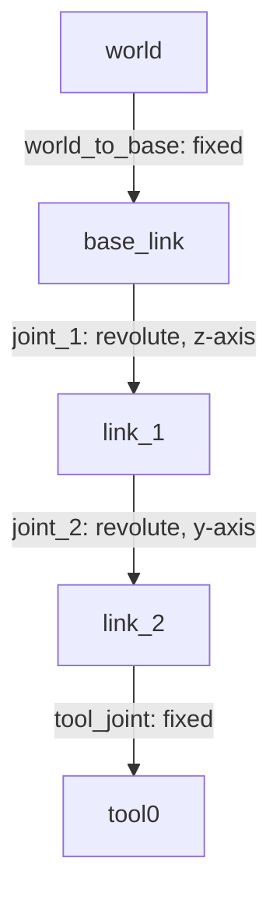
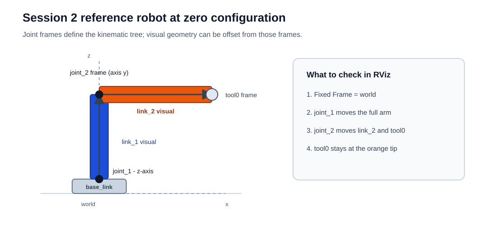
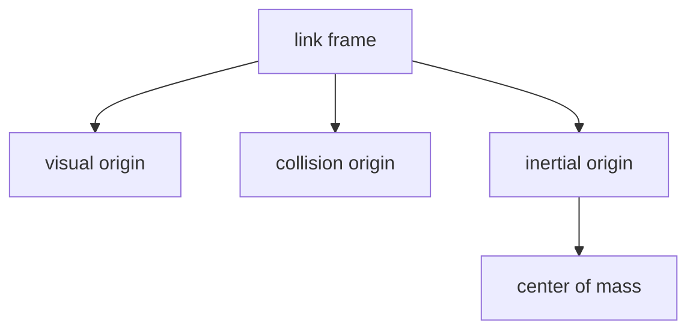
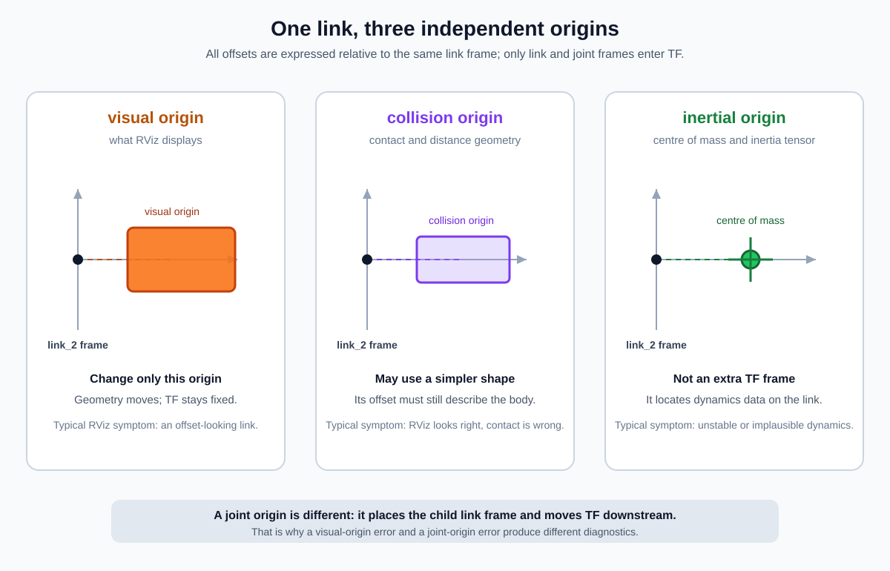
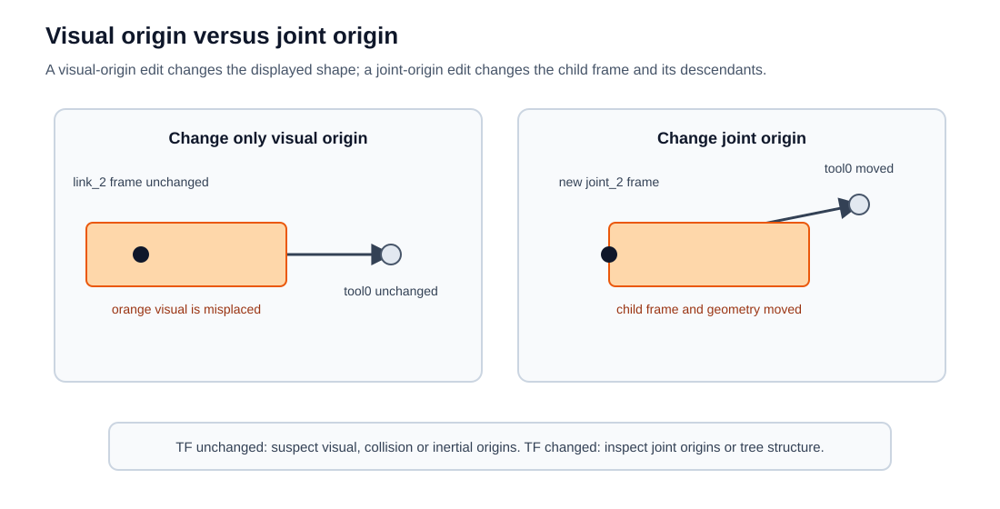
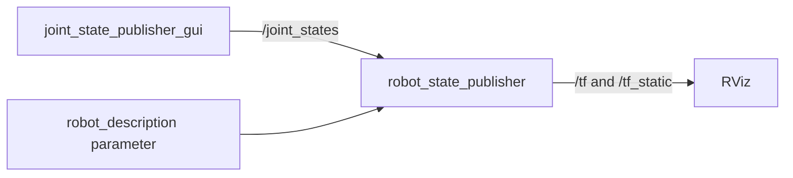

# Session 2 - URDF, TF and RViz
This session explains how a robot model becomes a visible, inspectable TF tree in ROS 2. You will first use a small 2-DOF robot as a laboratory model, then modify it, debug it, convert it to Xacro and connect the same ideas to Panda, Husky and the final projects.

The goal is not to become an expert CAD modeller. The goal is to be able to open an existing robot description, understand what each frame means, make controlled changes, and debug the result when RViz or TF disagrees with your expectation.

## Learning outcomes
At the end of this session, you should be able to:

- represent a robot as a directed tree of links and joints;
- explain the difference between a link frame and its visual, collision and inertial origins;
- choose joint type, origin, axis and limits deliberately;
- use `joint_state_publisher_gui`, `robot_state_publisher`, `/joint_states`, `/tf` and `/tf_static`;
- diagnose disconnected trees, wrong axes, missing transforms and misplaced visuals in RViz;
- validate a URDF with XML, URDF and TF tools before using it in a simulator;
- remove repetition with basic Xacro properties and macros;
- explain what URDF describes and why simulation scenes often also use SDF.

## 0. Prepare your working environment
### 0.1 Open the repository
Use the same repository layout as in Session 1. From an Ubuntu or WSL terminal:

Run each command separately:

```bash
cd ~/git/Robotics-II
```

```bash
code .
```

Keep the Explorer visible and open at least three terminals:

- **Terminal A** runs the visualizer launch file;
- **Terminal B** inspects ROS topics and TF;
- **Terminal C** edits files and runs validation commands.

### 0.2 Source and verify the workspace
Run this in every new terminal:

```bash
source ~/git/Robotics-II/scripts/setup_workspace.bash
```

Then verify the course environment:

```bash
~/git/Robotics-II/scripts/course_check.sh
```

The check should end with **Environment ready for Robotics II.**

If this fails, fix the setup first. URDF debugging is much harder when the ROS environment itself is unknown.

### 0.3 Check that the description packages are visible
Run each command separately:

```bash
ros2 pkg prefix robotics_ii_description
```

```bash
ros2 pkg prefix urdf_visualizer
```

Both commands should print an installed package path. If a package is not found, rebuild:

```bash
cd ~/git/Robotics-II/ros2_ws
```

```bash
colcon build --symlink-install --cmake-args -DBUILD_TESTING=OFF
```

```bash
source ~/git/Robotics-II/scripts/setup_workspace.bash
```

## 1. A URDF is a tree, not a drawing
Open:

```text
~/git/Robotics-II/ros2_ws/src/robotics_ii_description/urdf/tutorial_robot.urdf
```

The model is intentionally small:





A valid URDF robot has one root link. Every other link has exactly one parent joint. This makes the model a tree. A closed kinematic loop cannot be represented directly as a plain URDF tree.

Before running anything, read the URDF and complete this table in your notes:

| Joint | Type | Parent link | Child link | Origin `xyz` | Axis |
| --- | --- | --- | --- | --- | --- |
| `world_to_base` | | | | | |
| `joint_1` | | | | | |
| `joint_2` | | | | | |
| `tool_joint` | | | | | |

Questions before launching:

1. Which link is the root of the tree?
2. Which joint should rotate around the vertical axis?
3. Which joint should move the orange link up and down?
4. Where do you expect the `tool0` frame to be when both joint sliders are zero?

## 2. Launch the reference robot
In Terminal A:

Run each command separately:

```bash
source ~/git/Robotics-II/scripts/setup_workspace.bash
```

```bash
ros2 launch robotics_ii_description tutorial_robot.launch.py
```

RViz and `joint_state_publisher_gui` should open. Keep Terminal A running.

In RViz:

- in **Global Options → Fixed Frame**, select `world` if it is not already selected;
- enable or inspect the **RobotModel** display;
- expand **TF** if it is visible;
- move `joint_1` and `joint_2` one at a time with the sliders.

Expected observations:

| Action | Expected behavior |
| --- | --- |
| Move `joint_1` | The whole arm rotates around the vertical z-axis at the base. |
| Move `joint_2` | Only `link_2` and `tool0` move relative to `link_1`. |
| Move both joints | `tool0` follows the end of the orange link. |
| Set both sliders to zero | The robot returns to the kinematic tree described in the URDF origins. |

Take one RViz screenshot with both joints at zero and one screenshot with both joints nonzero. These screenshots are part of your exit evidence.

## 3. Validate the model before trusting the visualization
In Terminal B:

Run each command separately:

```bash
source ~/git/Robotics-II/scripts/setup_workspace.bash
```

```bash
xmllint --noout ~/git/Robotics-II/ros2_ws/src/robotics_ii_description/urdf/tutorial_robot.urdf
```

```bash
check_urdf ~/git/Robotics-II/ros2_ws/src/robotics_ii_description/urdf/tutorial_robot.urdf
```

`xmllint` checks whether the XML is well-formed. `check_urdf` checks whether the URDF can be parsed as a robot model. These are different checks. A file can be valid XML and still be a bad robot description.

Now inspect the running ROS graph:

```bash
ros2 node list --no-daemon
```

You should see at least:

```text
/joint_state_publisher_gui
/robot_state_publisher
/rviz2
```

Inspect the joint states:

```bash
ros2 topic echo --no-daemon /joint_states --once
```

Expected joint names:

```text
joint_1
joint_2
```

Only movable joints appear in `/joint_states`. Fixed joints such as `world_to_base` and `tool_joint` do not need sliders.

## 4. Read links: frame, visual, collision and inertia
The tag:

```xml
<link name="link_2">
```

creates a frame called `link_2`. The visible orange box is not automatically centered where you imagine the physical link should be. It is placed by the `<visual><origin .../>` tag.

Inside one link, four coordinate choices matter:



| URDF element | Meaning | Used by |
| --- | --- | --- |
| `link name` | The coordinate frame of the rigid body. | TF, joints, downstream frames. |
| `visual` | Geometry shown to humans. | RViz and visual rendering. |
| `collision` | Geometry used for contact and distance. | Simulation and planning. |
| `inertial` | Mass, center of mass and inertia tensor. | Dynamics simulation. |



The three origins are expressed relative to the same link frame, but they do
not all create TF frames. `visual` changes what RViz displays, `collision`
changes the geometry used for contact or distance queries, and `inertial`
locates the centre of mass and its inertia tensor. Only the link frame and
joint frames belong to the kinematic TF tree.

For `link_2`, the box length is 0.36 m along x. The `link_2` frame is at the joint, so the box center is offset by 0.18 m:

```xml
<origin xyz="0.18 0 0" rpy="0 0 0"/>
<geometry><box size="0.36 0.065 0.065"/></geometry>
```

This is why the orange link extends forward from the joint instead of being centered half forward and half backward.

### 4.1 Controlled visual-origin experiment
Make a copy for experiments:

```bash
cp ~/git/Robotics-II/ros2_ws/src/robotics_ii_description/urdf/tutorial_robot.urdf \
   /tmp/tutorial_robot_visual_test.urdf
```

Open the temporary copy in VS Code so that the file can be edited:

```bash
code /tmp/tutorial_robot_visual_test.urdf
```

In `link_2`, change only the visual origin:

```xml
<visual>
  <origin xyz="0 0 0" rpy="0 0 0"/>
```

Do not change the collision or inertial origin yet.

Launch the modified file:

```bash
ros2 launch robotics_ii_description tutorial_robot.launch.py \
  model:=/tmp/tutorial_robot_visual_test.urdf
```

Observe:

- the orange box appears centered around `link_2`;
- the `link_2` frame did not move;
- the `tool0` frame did not move;
- this is a visual placement problem, not a kinematic tree problem.

Stop the launch with `Ctrl+C` before continuing.

### 4.2 Collision and inertia should match the physical body
A common beginner mistake is to fix only what RViz shows. That can leave collision or inertia inconsistent with the visible robot.

For a uniform box of mass \(m\) and side lengths \(x\), \(y\), and \(z\), centered at its center of mass and aligned with the box axes, the three diagonal inertia terms are:

$$
\begin{aligned}
I_{xx} &= \frac{m}{12}(y^2+z^2),\\
I_{yy} &= \frac{m}{12}(x^2+z^2),\\
I_{zz} &= \frac{m}{12}(x^2+y^2).
\end{aligned}
$$

Here, $I_{xx}$, $I_{yy}$, and $I_{zz}$ are measured in $\mathrm{kg\,m^2}$. Each term describes resistance to rotation about the matching axis.

For the Session 2 robot, you do not need to derive every inertia manually during the lab. You do need to recognize physically impossible metadata:

| Bad metadata | Why it matters |
| --- | --- |
| Missing mass on a moving physical link | Dynamics simulation cannot compute realistic motion. |
| Zero or negative mass | Physically impossible. |
| Inertia values copied blindly from another shape | Simulated motion may become unstable. |
| Visual and collision origins describing different bodies | RViz looks right while contact/planning behaves differently. |

RViz is necessary, but not sufficient. It checks what you see, not whether the model is dynamically meaningful.

#### Mini-calculation: check `link_2`

Use the box dimensions from the URDF (`x = 0.36`, `y = 0.065`,
`z = 0.065` m) and its mass (`m = 0.6` kg). Calculate the three diagonal
terms on paper or with a calculator, then compare them with the values in
`tutorial_robot.urdf`.

You should obtain approximately:

$$
\begin{aligned}
I_{xx} &= \frac{0.6}{12}(0.065^2+0.065^2)
       = 0.0004225\;\mathrm{kg\,m^2},\\
I_{yy} &= \frac{0.6}{12}(0.36^2+0.065^2)
       \approx 0.0066913\;\mathrm{kg\,m^2},\\
I_{zz} &= \frac{0.6}{12}(0.36^2+0.065^2)
       \approx 0.0066913\;\mathrm{kg\,m^2}.
\end{aligned}
$$

The rounded URDF values are therefore reasonable. The purpose is not to
memorise the formulas; it is to develop the habit of checking whether a
declared inertia matches the geometry and mass of the link.

### 4.3 RViz2 diagnostic inspection

The default RViz configuration shows the visual model only, so that the
robot remains easy to read. For a diagnostic pass, expand the **RobotModel**
display in the left panel and inspect these properties:

1. Enable **Collision Enabled** and compare the collision geometry with the
   visual geometry.
2. Toggle **Visual Enabled** off and on to make clear which layer is being
   displayed.
3. If your RViz2 build exposes them, enable **Mass Properties → Mass** and
   **Mass Properties → Inertia**. These overlays are diagnostic markers, not
   additional TF frames.
4. Move `joint_2` while the diagnostic properties are visible. The whole
   `link_2` body moves with its frame, while the visual, collision and
   inertial data remain attached to that same rigid body.

Record one observation for each display mode. If a particular RViz2 build does
not expose the mass/inertia overlays, inspect the corresponding `<inertial>`
block in the URDF and keep the calculation above as the evidence.

Take one optional screenshot with the collision or mass-properties overlay
enabled. It is useful evidence for the difference between a model that merely
looks correct and a model that also contains simulator-relevant data.

## 5. Read joints: origin, axis and limit
A joint defines the child link frame relative to the parent link frame when the joint coordinate is zero.

For a revolute joint:

| Field | Meaning |
| --- | --- |
| `parent` | Link before the joint in the tree. |
| `child` | Link after the joint in the tree. |
| `origin xyz/rpy` | Position and orientation of the joint frame relative to the parent. |
| `axis xyz` | Rotation axis expressed in the joint frame. |
| `limit lower/upper` | Allowed joint range in radians. |
| `limit effort/velocity` | Physical actuator limits used by controllers/simulators. |

### 5.1 Controlled joint-axis experiment
Copy the reference model:

```bash
cp ~/git/Robotics-II/ros2_ws/src/robotics_ii_description/urdf/tutorial_robot.urdf \
   /tmp/tutorial_robot_axis_test.urdf
```

```bash
code /tmp/tutorial_robot_axis_test.urdf
```

In `/tmp/tutorial_robot_axis_test.urdf`, find the `<joint name="joint_1">` block and change only its axis:

```xml
<axis xyz="0 1 0"/>
```

In the supplied model, `joint_1` currently has `<axis xyz="0 0 1"/>`, while `joint_2` already has `<axis xyz="0 1 0"/>`. Leave the `joint_2` axis unchanged.

Validate and launch:

```bash
xmllint --noout /tmp/tutorial_robot_axis_test.urdf
```

```bash
check_urdf /tmp/tutorial_robot_axis_test.urdf
```

```bash
ros2 launch robotics_ii_description tutorial_robot.launch.py \
  model:=/tmp/tutorial_robot_axis_test.urdf
```

Move the `joint_1` slider. Write one sentence explaining how the movement changed.

### 5.2 Controlled joint-origin experiment
Make a second copy:

```bash
cp ~/git/Robotics-II/ros2_ws/src/robotics_ii_description/urdf/tutorial_robot.urdf \
   /tmp/tutorial_robot_origin_test.urdf
```

```bash
code /tmp/tutorial_robot_origin_test.urdf
```

Change only the origin of `joint_2`:

```xml
<origin xyz="0.10 0 0.40" rpy="0 0 0"/>
```

Launch and move `joint_2`. Compare this with the visual-origin experiment:

| Change | What moved? | What did not move? |
| --- | --- | --- |
| `visual` origin | Only the displayed geometry. | TF frames and child joints. |
| `joint` origin | Child frame and all downstream frames. | Parent frame. |



This distinction is one of the most important ideas in the session.

### 5.3 Controlled joint-limit experiment
Make a third copy:

```bash
cp ~/git/Robotics-II/ros2_ws/src/robotics_ii_description/urdf/tutorial_robot.urdf \
   /tmp/tutorial_robot_limit_test.urdf
```

```bash
code /tmp/tutorial_robot_limit_test.urdf
```

Change only the limits of `joint_2`:

```xml
<limit lower="-0.30" upper="0.30" effort="10.0" velocity="1.5"/>
```

Relaunch. The slider range should become smaller. The geometry and tree are unchanged, but the allowed coordinate interval changed.

## 6. From joint states to TF and RViz
The running system has a simple data flow:



`joint_state_publisher_gui` publishes the current values of movable joints. `robot_state_publisher` combines those joint values with the URDF tree. RViz displays the resulting transforms and geometry. RViz does not compute the robot kinematics by itself.

Section 4.1 stopped the reference launch before the temporary-file experiments.
Start it again in Terminal A:

```bash
ros2 launch robotics_ii_description tutorial_robot.launch.py
```

In the new RViz window, select `world` in **Global Options → Fixed Frame** if
needed. Keep this Terminal A launch and RViz window open while you inspect TF
from Terminal B; do not start a second copy of the reference launch.

Run each command separately:

```bash
ros2 topic info --no-daemon /tf --verbose
```

```bash
ros2 topic info --no-daemon /tf_static --verbose
```

```bash
ros2 run tf2_ros tf2_echo world tool0
```

Move the GUI sliders and watch the transform update. Stop `tf2_echo` with `Ctrl+C`.

Generate a TF tree:

```bash
cd ~/git/Robotics-II/exercises/session_2
```

```bash
ros2 run tf2_tools view_frames
```

This writes `frames.pdf` in the current directory. Compare it with your joint table. The names and parent-child relationships should match the URDF.

### 6.1 Manual zero-configuration prediction
With both sliders at zero:

- `world_to_base` translates 0.04 m in z;
- `joint_1` is located at the top of `base_link`;
- `link_1` extends 0.40 m upward visually;
- `joint_2` is at the top of `link_1`;
- `tool_joint` is 0.36 m along x from `link_2`.

Predict the approximate position of `tool0` relative to `world` when both joint angles are zero. Then compare with:

```bash
ros2 run tf2_ros tf2_echo world tool0
```

The numbers do not need to be memorized. The important part is that you can explain where they come from in the URDF.

## 7. Complete your own 2-DOF model
The reference model is complete. Your task is to complete a starter model incrementally.

Copy the starter:

```bash
cp ~/git/Robotics-II/ros2_ws/src/robotics_ii_description/urdf/tutorial_robot_student.urdf \
   ~/git/Robotics-II/exercises/session_2/my_robot.urdf
```

Open:

```text
~/git/Robotics-II/exercises/session_2/my_robot.urdf
```

Follow the detailed exercise instructions:

[Session 2 exercise - complete and diagnose a robot description](../../exercises/session_2/README.md)

The recommended build order is:

| Step | Add or modify | Validate before continuing |
| --- | --- | --- |
| 1 | Add `link_2` visual geometry. | `xmllint` and RViz. |
| 2 | Add `joint_2` with parent `link_1` and child `link_2`. | `check_urdf`, sliders. |
| 3 | Add collision to `link_2`. | Visual and collision origins match. |
| 4 | Add inertial to `link_2`. | Positive mass and plausible inertia. |
| 5 | Add fixed `tool0` frame. | `tf2_echo world tool0`. |
| 6 | Complete evidence. | `frames.pdf`, screenshots, joint table. |

Launch your model by absolute path:

```bash
ros2 launch robotics_ii_description tutorial_robot.launch.py \
  model:=$HOME/git/Robotics-II/exercises/session_2/my_robot.urdf
```

Do not make five edits and then test. Make one structural edit, validate, launch, observe, then continue.

## 8. Diagnose common failures
Use this order when something looks wrong:

1. Validate XML:

   ```bash
   xmllint --noout ~/git/Robotics-II/exercises/session_2/my_robot.urdf
   ```

2. Validate URDF semantics:

   ```bash
   check_urdf ~/git/Robotics-II/exercises/session_2/my_robot.urdf
   ```

3. Confirm joint states exist:

   ```bash
   ros2 topic echo --no-daemon /joint_states --once
   ```

4. Confirm the requested transform:

   ```bash
   ros2 run tf2_ros tf2_echo world tool0
   ```

5. Generate the TF tree:

   ```bash
   ros2 run tf2_tools view_frames
   ```

6. In RViz, check **Fixed Frame** and the RobotModel status panel.

Typical symptoms:

| Symptom | Likely cause | First tool to use |
| --- | --- | --- |
| Launch fails before RViz opens | XML syntax error, missing file or bad Xacro expansion. | `xmllint`, terminal output. |
| RViz says `No transform from ...` | Disconnected link, misspelled frame or wrong fixed frame. | `view_frames`, RViz Fixed Frame. |
| A slider is missing | Joint is fixed, missing limits or model did not parse. | `/joint_states`, `check_urdf`. |
| Link rotates around the wrong line | Wrong `axis`, or joint `rpy` changed the joint frame. | RViz sliders, joint table. |
| Geometry moves correctly but appears offset | Wrong `visual` origin. | RViz RobotModel display. |
| Downstream frames are offset | Wrong `joint` origin. | `tf2_echo`, `view_frames`. |
| Looks fine in RViz but simulator later behaves badly | Missing or inconsistent mass, inertia or collision. | URDF review, simulator logs. |

## 9. Replace repetition with Xacro
URDF is explicit, but repeated dimensions and inertias become tedious. Xacro lets you generate URDF from properties and macros.

Open:

```text
~/git/Robotics-II/ros2_ws/src/robotics_ii_description/urdf/tutorial_robot.urdf.xacro
```

Look for:

- `xacro:property` values for shared dimensions;
- macros that create repeated link structure;
- arithmetic expressions for visual origins and inertia values;
- normal URDF joints connecting the generated links.

Expand and validate:

```bash
ros2 run xacro xacro \
  ~/git/Robotics-II/ros2_ws/src/robotics_ii_description/urdf/tutorial_robot.urdf.xacro \
  > /tmp/tutorial_robot_from_xacro.urdf
```

```bash
xmllint --noout /tmp/tutorial_robot_from_xacro.urdf
```

```bash
check_urdf /tmp/tutorial_robot_from_xacro.urdf
```

Launch the Xacro directly:

```bash
ros2 launch robotics_ii_description tutorial_robot.launch.py \
  model:=$HOME/git/Robotics-II/ros2_ws/src/robotics_ii_description/urdf/tutorial_robot.urdf.xacro
```

The launch file expands Xacro automatically before passing `robot_description` to the publishers.
In RViz, confirm that **Global Options → Fixed Frame** is set to `world`.

### 9.1 Controlled Xacro edit
Make a temporary copy:

```bash
cp ~/git/Robotics-II/ros2_ws/src/robotics_ii_description/urdf/tutorial_robot.urdf.xacro \
   /tmp/tutorial_robot_longer.xacro
```

```bash
code /tmp/tutorial_robot_longer.xacro
```

Change one property, for example:

```xml
<xacro:property name="link_length" value="0.50"/>
```

The source property is named `link_length`; it controls the orange link geometry and the downstream `tool0` position.

Relaunch:

```bash
ros2 launch robotics_ii_description tutorial_robot.launch.py \
  model:=/tmp/tutorial_robot_longer.xacro
```

Observe that the orange link geometry and the downstream `tool0` frame move consistently. That is the main reason to use Xacro: one physical dimension can drive all dependent origins and inertias.

## 10. Connect this to Panda, Husky and Session 3
The 2-DOF robot is small on purpose. The same questions apply to larger robots:

| Small model question | Panda/Husky/project version |
| --- | --- |
| What is the root link? | Which frame is the robot base or world frame? |
| What are the movable joints? | Which names must controllers command? |
| Where is `tool0`? | Where is the gripper, end-effector or sensor frame? |
| Are visual and collision origins consistent? | Does planning/simulation use a different geometry from what RViz shows? |
| Are mass and inertia present? | Can Drake or another simulator compute dynamics reliably? |
| Does `tf2_echo` find the transform? | Can downstream code request the frames it needs? |

URDF, Xacro and SDF have different jobs:

| Format | Best used for | Important limitation here |
| --- | --- | --- |
| URDF | One robot's links, joints, visuals, collision and inertia. | Tree structure; limited scene composition. |
| Xacro | Generating maintainable URDF from properties/macros. | Must be expanded before plain URDF parsers consume it. |
| SDF | Worlds, static objects, multiple models and richer simulation properties. | Not the message consumed directly by `robot_state_publisher`. |

In Session 3, Drake will parse robot models and build simulation diagrams. The URDF concepts from this session tell you what the parser is reading. The simulator adds dynamics, contact, controllers and scene composition.

## 11. Exit evidence
Keep the following in your work log:

- completed joint/link table for the reference robot;
- zero and nonzero RViz screenshots of the reference robot;
- your completed `my_robot.urdf`;
- `xmllint` and `check_urdf` success output for `my_robot.urdf`;
- `frames.pdf` for your completed model;
- one `tf2_echo world tool0` measurement in a nonzero configuration;
- short notes comparing visual-origin and joint-origin errors;
- one diagnostic RViz2 observation comparing visual, collision and inertial data;
- a Xacro variant and its expanded, validated URDF.

You are ready for Session 3 when you can predict which frames move after a joint coordinate changes, distinguish geometry placement from frame placement, and explain why a model that looks correct in RViz may still need collision and inertia data for simulation.

## Troubleshooting
### RViz opens but the robot does not appear
Check the Fixed Frame. For the tutorial robot it should be:

```text
world
```

Then check the RobotModel display status. It usually reports the missing frame, missing mesh or robot description problem.

### The joint sliders are missing
Check whether the model has movable joints with limits:

```bash
check_urdf ~/git/Robotics-II/exercises/session_2/my_robot.urdf
```

Then inspect `/joint_states`:

```bash
ros2 topic echo --no-daemon /joint_states --once
```

If `/joint_states` does not contain your joint name, the joint is probably fixed, invalid or the model did not parse.

### `tf2_echo world tool0` cannot find the transform
Generate the tree:

```bash
ros2 run tf2_tools view_frames
```

Open `frames.pdf` and check whether `tool0` exists and whether it is connected to `world`.

### Xacro launches fail but URDF works
First expand the Xacro manually:

```bash
ros2 run xacro xacro MODEL.xacro > /tmp/model.urdf
```

Then validate the generated URDF:

```bash
xmllint --noout /tmp/model.urdf
```

```bash
check_urdf /tmp/model.urdf
```

This separates Xacro syntax problems from URDF model problems.

## Official reading
- [ROS 2 URDF tutorials](https://docs.ros.org/en/jazzy/Tutorials/Intermediate/URDF/URDF-Main.html)
- [tf2 tutorials](https://docs.ros.org/en/jazzy/Tutorials/Intermediate/Tf2/Tf2-Main.html)
- [Debugging tf2](https://docs.ros.org/en/jazzy/Tutorials/Intermediate/Tf2/Debugging-Tf2-Problems.html)
- [Xacro documentation](https://docs.ros.org/en/ros2_packages/rolling/api/xacro/)
