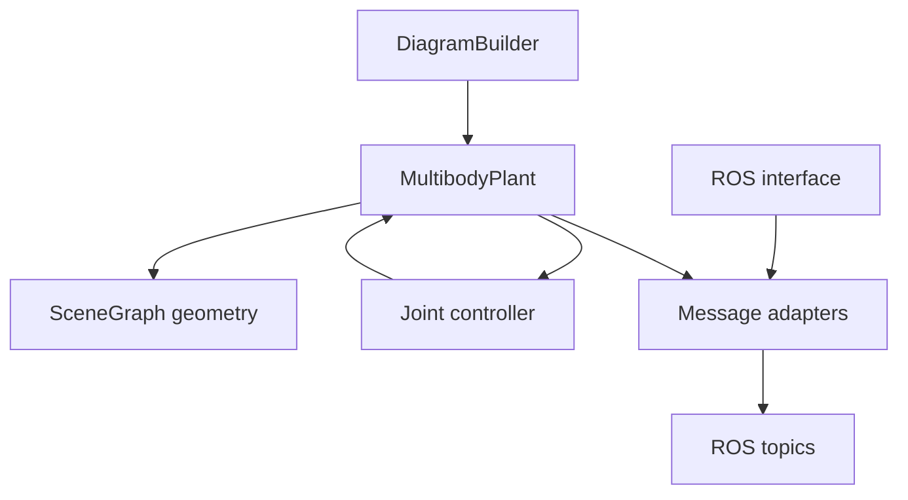
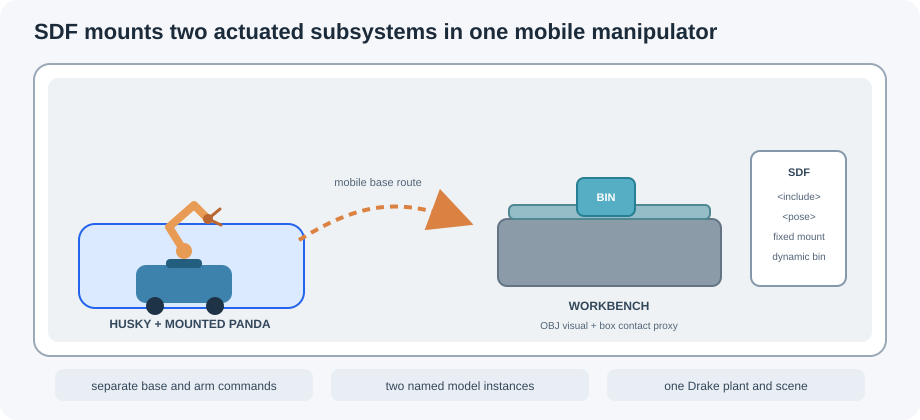
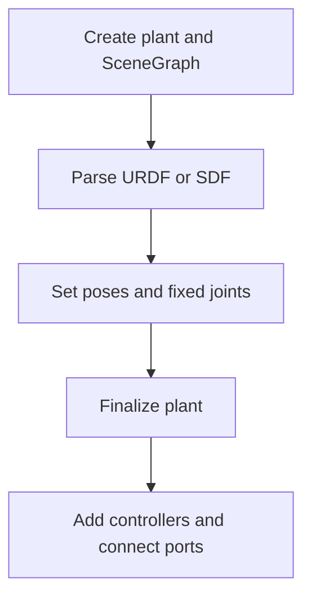
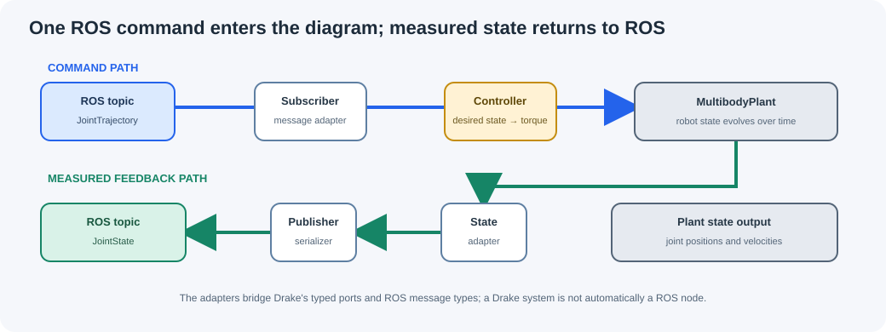

# Session 3 — Drake simulation systems, SDF worlds, and ROS 2

## Goal

Connect the ROS 2 graph from Session 1 to the robot descriptions from Session 2.
You will trace how Drake parses a URDF or SDF model, assembles a system
diagram, advances a MultibodyPlant, and converts state and commands into typed
ROS messages. You will then inspect a world containing two robot instances,
which is the scene structure used in Sessions 4–6.

## Learning outcomes

By the end of this session, you should be able to:

- explain the role of `DiagramBuilder`, `MultibodyPlant`, `SceneGraph`, `Parser`,
  `Finalize()`, `Simulator`, and system ports;
- distinguish a Drake system from a ROS 2 node and identify which side owns a
  connection;
- explain how a publisher adapter converts a Drake vector into a typed ROS
  message;
- trace a named Panda joint goal into the controller and trace measured joint
  state back to ROS;
- describe what SDF adds when a world contains several models, static fixtures,
  poses, and model includes;
- parse a project SDF into one plant and list its robot model instances;
- explain how the Husky base and mounted Panda arm form the course's
  multi-robot mobile manipulator;
- trace its base, arm, and gripper command and measured-feedback interfaces.

## 0. Prepare the workspace

From the repository root, source the course setup in each terminal:

```bash
source scripts/setup_workspace.bash
```

Use Terminal A for a launch process and Terminal B for inspection commands.
Leave Terminal A running while you inspect topics from Terminal B. In this
course, use `--no-daemon` with `ros2 node list`, `ros2 node info`,
`ros2 topic list`, `ros2 topic info`, and `ros2 topic echo` so each graph
inspection uses live discovery. `ros2 topic hz` measures a stream and does not
accept this option.

## 1. A Drake diagram is a typed signal graph

A Drake diagram is a collection of systems connected through compatible ports.
Each system has an input/output contract; a connection sends an output value
from one system to an input on another. A ROS topic is a separate communication
contract. An adapter is required when a Drake vector or abstract value has to
be represented as a ROS message.



These are not seven ROS nodes. Most are Drake systems that run inside one
simulation process. `RosInterfaceSystem` connects that process to ROS. The
ROS 2 tools discover the process as one node and its published/subscribed
topics.

### Three layers to keep separate

| Layer | Example in this repository | What it owns |
| --- | --- | --- |
| Robot/world model | Panda URDF, Husky URDF, project SDF | Links, joints, geometry, inertias, frames, and model poses. |
| Drake diagram | Plant, controller, state adapters, simulator | State evolution and connections between numerical systems. |
| ROS 2 graph | `/panda/joint_trajectory`, `/sim_sys/joint_states` | Process-level communication through typed messages. |

When a robot does not move, first identify which layer failed. A missing SDF
include is a model-loading problem. An unconnected controller port is a Drake
diagram problem. A missing topic endpoint is a ROS graph problem.

## 2. Build order: models first, then ports, then simulation

The source code constructs the diagram in a deliberate order:

1. create a `DiagramBuilder`;
2. add the ROS interface and clock systems;
3. add `MultibodyPlant` and its `SceneGraph`;
4. parse robot and world models;
5. weld or place model frames and set default joint positions;
6. call `plant.Finalize()`;
7. add controllers, adapters, publishers, and subscribers;
8. connect compatible ports, build the diagram, and initialize the simulator.

`Finalize()` freezes the plant topology. After it is called, code cannot add
another link, joint, actuator, or parsed model to that plant. A common failure
is to place `Parser.AddModels(...)` after `Finalize()`; move model parsing
earlier instead of attempting to modify the built diagram.

### Plant time step and output rates

The Panda plant uses a 0.001 s discrete time step, which corresponds to a
1000 Hz state update. The visualization and TF systems publish at about 32 Hz;
the Panda joint-state and acceleration publishers publish every 0.02 s, or
50 Hz. These rates differ because numerical integration, human visualization,
and ROS monitoring have different requirements.

Do not infer the simulator time step from `ros2 topic hz`. That command measures
the rate at which a ROS publisher sends messages; it does not measure every
internal plant update.

## 3. URDF and SDF describe related but different things

Session 2 used URDF to describe one robot as a kinematic tree. SDF can describe
a complete world containing multiple robot models, static objects, surfaces,
poses, and model includes. Drake's `Parser` can load both formats into a
`MultibodyPlant`.

| Description | Typical contents in this course | Useful when |
| --- | --- | --- |
| URDF | One robot's links, joints, inertias, collision and visual geometry | Inspecting or changing one robot model. |
| Xacro | URDF generated from properties and macros | Reusing dimensions or repeating links. |
| SDF | A world with model instances, includes, poses, and fixed fixtures | Preparing a project scene with multiple robots and props. |

An SDF pose contains six values in this order:

```text
x  y  z  roll  pitch  yaw
```

Positions are in metres and angles are in radians. For example,
`<pose>1.0 0.5 0.2 0 0 1.57</pose>` places a model at that translation and turns
it about the world z-axis by about 90 degrees.

### 3.1 Read a world file

Open the two-Husky scene:

```bash
code models/team_projects/two_husky_corridor.sdf
```

The world includes the same Husky URDF twice, with different instance names and
initial poses. The walls and colored zones are simple box geometry. No external
environment package is required.

The structure is:

```xml
<sdf xmlns:drake="http://drake.mit.edu" version="1.6">
  <world name="two_husky_corridor">
    <include>
      <uri>package://robotics_ii_models/descriptions/robots/mobile/clearpath_husky/urdf/husky.urdf</uri>
      <name>husky_a</name>
      <pose>-3.2 0 0.13228 0 0 0</pose>
    </include>
    <model name="north_wall">
      <static>true</static>
      <pose>0 1.25 0.6 0 0 0</pose>
      <link name="wall">
        <visual name="visual">...</visual>
        <collision name="collision">...</collision>
      </link>
    </model>
  </world>
</sdf>
```

`<include>` reuses an existing model file. `<name>` gives this instance a
unique name in the world. `<static>true</static>` marks a fixture that does not
move. A link may have separate visual and collision geometry: the visual is
rendered, while the collision geometry participates in contact and distance
queries.

The project scenes use the `drake:` XML namespace for Drake-specific contact
properties when they are needed. Keep the namespace declaration on the root
`<sdf>` element when editing such a file.



In the mounted mobile-manipulator scene, both robot instances and the
workbench are in one world. The Husky is free to move on the floor, and the
Panda base is attached to the Husky top plate with a fixed joint. The arm and
the mobile base remain separately actuated. The 73 cm workbench has four legs
that reach the floor. The dynamic open-top tote has separate wall and bottom
collision boxes, so it can be grasped by the Panda; visual markers in the
older inspection scene cannot be sensed or grasped.

### 3.2 Package URIs need a package map

The project worlds reuse robot files with URIs such as:

```text
package://robotics_ii_models/descriptions/robots/...
```

The local directory `models/` supplies the resources for this course package
name. Add the mapping to the same parser that will load the world. In the
Session 3 scripts, the exact insertion point is immediately after
`model_parser = Parser(plant)` and before `model_parser.AddModels(...)`:

```python
model_parser = Parser(plant)
model_parser.package_map().Add("robotics_ii_models", str(root / "models"))
model_parser.AddModels(file_name=str(scene_path))
plant.Finalize()
```

Do not add this line after `AddModels()` or create a second parser: the parser
must know the package root before it resolves the SDF's `package://` includes.
Without the mapping, Drake may report that it cannot resolve a package URI,
even when the model file is present in the repository. The project-world
checker already applies this mapping.

### 3.3 Add an OBJ mesh to an SDF scene

The project scenes store custom meshes in the lowercase directory
`models/team_projects/assets/`. It already contains `workbench.obj`, which the
mounted pick-and-place scene uses for the workbench visual. There is no
capitalized `Assets` directory. The Panda model is a robot description under
`models/descriptions/robots/arms/panda_fer/urdf/`; it is included by the SDF
and does not belong in the project-mesh directory. See
[`models/team_projects/assets/README.md`](../../models/team_projects/assets/README.md)
for the directory contents and mesh workflow.

Drake's SDF mesh URI points to an OBJ file; convert an STL to OBJ before
referencing it. Store the OBJ and any referenced MTL or texture files together
under `models/team_projects/assets/`:

```xml
<visual name="machine_visual">
  <geometry><mesh>
    <uri>package://robotics_ii_models/team_projects/assets/machine.obj</uri>
    <scale>1 1 1</scale>
  </mesh></geometry>
</visual>
<collision name="machine_collision_proxy">
  <geometry><box><size>0.6 0.4 0.5</size></box></geometry>
</collision>
```

Export the OBJ with the desired dimensions in metres. The Drake version used
in this course requires uniform mesh scaling, so bake dimensions and any
different per-axis scaling into the mesh before export; use `<scale>1 1 1</scale>`
in the SDF. Keep a simple collision proxy unless detailed contact is
necessary, and parse the scene after each change. Section 3.4 explains how
that geometry differs from an object's static or dynamic behavior. The
[`Session 3 exercise`](../../exercises/session_3/README.md) includes a complete
asset example and mesh-check procedure.

### 3.4 Static and dynamic objects

Use `<static>true</static>` for a wall, workbench, marker board, or other fixed
fixture. A dynamic object needs a valid mass and inertia and should have
collision geometry if contact matters. The pick-and-place scene includes a
dynamic supply bin with contact geometry; visual-only markers cannot be
grasped.

For every SDF model, answer these questions before loading it:

1. What is its model-instance name?
2. Where does the six-value pose place it?
3. Does it move, remain fixed, or exist only for visualization?
4. Which links have visual geometry, collision geometry, and inertial data?
5. Does it contain `package://` includes, and where does the package map point?

## 4. Parse a project world into one plant

The project world checker runs Drake's parser and verifies that both robot
instances are present in one finalized plant. From the repository root, run:

```bash
python3 exercises/session_3/check_project_world.py dual_panda_inspection.sdf
```

Try the other scenes as well:

```bash
python3 exercises/session_3/check_project_world.py two_husky_corridor.sdf
python3 exercises/session_3/check_project_world.py husky_panda_inspection.sdf
python3 exercises/session_3/check_project_world.py husky_panda_pick_place.sdf
```

The output lists the parsed model instances, the total number of plant
positions, and the number of actuated degrees of freedom. The checker validates
model parsing and names. It does not create command topics, odometry, a robot
controller, or a running simulation.

The checker also accepts a team SDF filename in `models/team_projects/`. Create
that file before checking it by copying a supplied world:

```bash
cp models/team_projects/husky_panda_pick_place.sdf \
  models/team_projects/team_01_world.sdf
python3 exercises/session_3/check_project_world.py team_01_world.sdf
```

For a custom name it verifies that the scene still contains `husky_runner` and
`panda_inspector`.

This is a parser and model-assembly check only. It does not start a ROS node,
publish `/sim_sys/joint_states`, or test RViz. Use Section 5 to launch the
baseline simulation and verify its live ROS graph.

This is an important project distinction: a world containing two models is a
multi-robot scene, but a complete multi-robot application also needs separate
command and feedback paths plus a coordinator.

## 5. Run and inspect the baseline Panda

In Terminal A, source the course environment and start exactly one simulator
instance with RViz:

```bash
source scripts/setup_workspace.bash
ros2 launch sim_systems panda_manipulator_py_launch.py rviz:=true simulation_sec:=inf
```

Keep Terminal A running. A Python traceback or a process that exits means the
plant did not start; resolve that launch error before checking topics. Do not
start a second copy of the same simulation in another terminal: duplicate
publishers can produce multiple `/clock` sources and time jumps in RViz.

In Terminal B, source the same course environment and check the middleware and
ROS domain before inspecting the live graph:

```bash
source scripts/setup_workspace.bash
echo "$RMW_IMPLEMENTATION"
echo "${ROS_DOMAIN_ID:-0}"
ros2 node list --no-daemon
ros2 topic list --no-daemon -t
ros2 topic echo --no-daemon /sim_sys/joint_states --once
```

The middleware should be `rmw_cyclonedds_cpp`; both terminals must report the
same ROS domain (the default is `0`). The expected node is
`/panda_manipulator`. The default RViz configuration uses `world` as its Fixed
Frame and the launch sets RViz to use simulation time.

The main baseline topics are:

| Topic | Type | Meaning |
| --- | --- | --- |
| `/clock` | `rosgraph_msgs/msg/Clock` | Drake simulation time. |
| `/sim_sys/joint_states` | `sensor_msgs/msg/JointState` | Seven arm and two finger joint states. |
| `/sim_sys/joint_acceleration` | `std_msgs/msg/Float64MultiArray` | Nine generalized accelerations. |
| `/tf` and visualization topics | TF and visualization messages | Scene frames and geometry for RViz. |

The baseline Panda has no ROS command topic. An internal joint-stiffness
controller with gravity-compensation feedforward holds the arm and open hand
near `PANDA_HOME`, so you can inspect the plant, state, and visualization
connections without also debugging a command interface. Gravity compensation
is sampled at 50 Hz; the controller provides position and velocity feedback
between updates. `SetDefaultPositions()` alone would only choose the initial
pose; it would not stop the articulated robot from moving under gravity.

To measure a ROS output rate, use a separate terminal:

```bash
ros2 topic hz /sim_sys/joint_states
```

Stop `ros2 topic hz` with `Ctrl+C`. It should measure close to 50 Hz, subject
to operating-system scheduling and discovery time.

## 6. Read `panda_manipulator.py` in five passes

Open the baseline implementation:

```bash
code ros2_ws/src/sim_systems/sim_systems/panda_manipulator.py
```

### Pass A — process, ROS interface, and clock

`drake_ros.core.init()` initializes the Drake–ROS integration. The diagram
contains one `RosInterfaceSystem`, which owns ROS communication for this
process, and a `ClockSystem`, which publishes simulation time. Nodes that use
simulated time can align their timestamps with the plant rather than the
computer's wall clock.

All simulation scripts use `simulation_arguments()` from
`sim_systems/course_utils.py`. ROS launch adds arguments such as
`--ros-args -r __node:=...`; the helper removes ROS arguments before the Python
argument parser reads `--simulation_sec` and `--realtime_rate`. This lets the
ROS layer receive its remapping arguments without `argparse` rejecting them.

### Pass B — plant, parser, and model topology

`AddMultibodyPlant(...)` adds a discrete-time plant and its SceneGraph. A
`Parser` reads the Panda URDF and resolves its mesh resources. The base is
welded to the plant's world frame; `plant.Finalize()` fixes the topology; then
`PANDA_HOME` sets the default arm-and-hand positions. An internal
`JointStiffnessController` receives a constant desired state `[PANDA_HOME, 0]`
and drives the plant actuators to hold that pose. This controller is local to
Drake; it does not add a ROS command topic. The hold controller is also why the
baseline Panda can remain still under gravity after initialization.

The order is important:



The Panda model contains seven revolute arm joints and two prismatic finger
joints. The session starts with the arm command and keeps both fingers at their
open defaults.

### Pass C — SceneGraph, TF, and visualization

The plant registers geometry in `SceneGraph`. `SceneTfBroadcasterSystem`
converts scene poses into TF, while `RvizVisualizer` publishes geometry for
RViz. Both are connected to the SceneGraph query output. They publish near
32 Hz even though the plant updates at 1000 Hz.

Set **RViz Global Options → Fixed Frame** to `world` if the RobotModel status
reports a missing fixed frame. A valid URDF does not guarantee that RViz is
using a frame name present in the model.

### Pass D — ROS message adapters

The plant state output is a numerical vector. A `JointStateMessageSystem`
converts position and velocity values into `sensor_msgs/msg/JointState`, adding
the nine joint names. `RosPublisherSystem` serializes and publishes that
message as `/sim_sys/joint_states`.

`VectorToFloatArraySystem` converts the nine generalized accelerations into a
`Float64MultiArray` for `/sim_sys/joint_acceleration`. The adapters are Drake
systems; the publisher systems own the ROS topic endpoints.

### Pass E — simulator and time advancement

`DiagramBuilder.Build()` freezes the full graph. `Simulator` creates its
context, initializes the systems, and advances simulation time. The shared
`run_simulator()` helper advances in 0.1 s chunks so that `Ctrl+C` remains
responsive when the duration is infinite.

Run a short headless smoke test:

```bash
ros2 launch sim_systems panda_manipulator_py_launch.py simulation_sec:=0.5 rviz:=false
```

This run intentionally opens no RViz window and exits after half a simulated
second. Use `rviz:=true simulation_sec:=inf` when you need to watch the robot.

## 7. Trace the controlled Panda command and feedback loop

The controlled Panda uses the same plant and adds a subscriber, a typed command
adapter, a joint-space controller, and diagnostic publishers. Start it through
the Session 1 launch, which also runs the commander and goal monitor:

```bash
ros2 launch robotics_ii_tutorials session1_panda.launch.py
```

The command path is:

1. `/panda/joint_trajectory` carries a named seven-joint arm target;
2. `RosSubscriberSystem` receives a `trajectory_msgs/msg/JointTrajectory`;
3. `JointTrajectoryToStateSystem` checks names, value count, finiteness, and
   Panda limits, then creates a desired position/velocity vector;
4. `JointStiffnessController` compares the desired state with measured plant
   state and computes feedback actuation; a sampled gravity-compensation system
   adds feedforward torque;
5. the plant evolves and publishes measured state and acceleration.

The reference adapter uses the final point as a setpoint and does not interpret
`time_from_start`. The commander republishes its valid target so that a
subscriber starting slightly later still receives it. If no valid target has
arrived, the arm remains at its safe home posture.

The session's command-and-feedback contract is:

| Topic | Type | Values |
| --- | --- | --- |
| `/panda/joint_trajectory` | `trajectory_msgs/msg/JointTrajectory` | Seven named arm positions; optional seven velocities. |
| `/sim_sys/desired_positions` | `std_msgs/msg/Float64MultiArray` | Nine validated desired positions: seven arm values and two open-finger values. |
| `/sim_sys/joint_states` | `sensor_msgs/msg/JointState` | Nine measured joint states, including names. |
| `/sim_sys/joint_acceleration` | `std_msgs/msg/Float64MultiArray` | Nine measured generalized accelerations. |
| `/panda/goal_reached` | `std_msgs/msg/Bool` | Whether measured arm positions are within the configured tolerance. |



The diagram is a data-flow view. The ROS 2 simulator process contains many
Drake systems, but it appears as one ROS node. The separate commander and goal
monitor from Session 1 are ROS nodes outside the simulator process.

Inspect the complete graph:

```bash
ros2 node list --no-daemon
ros2 topic list --no-daemon -t
ros2 topic echo --no-daemon /sim_sys/desired_positions --once
ros2 topic echo --no-daemon /sim_sys/joint_acceleration --once
ros2 topic echo --no-daemon /sim_sys/joint_states --once
```

The `Float64MultiArray` messages are numerical arrays. The joint-state message
also carries names; use those names when associating positions with Panda
joints rather than assuming a particular array order.

### Publish one safe target manually

Stop the Session 1 launch before taking control manually. In Terminal A, start
the controlled Panda simulator only:

```bash
ros2 launch sim_systems panda_manipulator_controller_py_launch.py rviz:=true simulation_sec:=inf
```

From Terminal B, publish one target:

```bash
ros2 topic pub --once /panda/joint_trajectory \
  trajectory_msgs/msg/JointTrajectory \
  "{joint_names: [panda_joint1, panda_joint2, panda_joint3, panda_joint4, panda_joint5, panda_joint6, panda_joint7], points: [{positions: [0.2, -0.6, 0.0, -2.0, 0.0, 1.7, 0.7], velocities: [0.0, 0.0, 0.0, 0.0, 0.0, 0.0, 0.0]}]}"
```

Read the joint state while the launch remains running. Compare the requested
joint positions with the named measured values; RViz motion alone is not an
acceptance test.

## 8. Add an SDF object to a Drake diagram

The baseline uses a URDF for the Panda robot. A world can include additional
SDF models before `Finalize()`. In `panda_manipulator.py`, the object parser is
created alongside the robot parser and uses the same model package map:

```python
model_parser = Parser(plant)
model_parser.package_map().Add("robotics_ii_models", str(root / "models"))
(panda,) = model_parser.AddModels(file_name=str(panda_file))
panda_link0 = plant.GetFrameByName("panda_link0", panda)
plant.WeldFrames(plant.world_frame(), panda_link0)

box_file = root / "exercises/session_3/static_box.sdf"
model_parser.AddModels(file_name=str(box_file))

# Parse all models and weld required frames before Finalize().
plant.Finalize()
```

For the exercise, use `exercises/session_3/static_box.sdf`. It is a small fixed
box placed away from the Panda base. Keep both visual and collision geometry;
the object is fixed, so it does not need a moving joint or controller. After
adding it, run the scene once with RViz and once without RViz. Confirm that the
simulation process starts in both cases.

The packaged `models/objects_scenes/box.sdf` is a separate model with its own
default pose and contact properties. Do not add it at the Panda base without
checking for overlap. A visual marker is not a dynamic object and cannot be
grasped.

## 9. Compare the supplied simulation examples

| Example | Loaded description | What the current code publishes | What remains project work |
| --- | --- | --- | --- |
| Panda | Panda arm-and-hand URDF | TF/visualization, joint states, accelerations; controlled version also accepts a trajectory. | Second-arm command routing, timed interpolation, and collision-aware planning. |
| Husky | Husky URDF plus floor SDF | TF and visualization for one free-base Husky. | Wheel command interface, odometry, mobile navigation, and multiple Husky instances. |
| Husky-Panda mobile manipulator | `models/team_projects/husky_panda_pick_place.sdf`; the Panda is fixed to the Husky top plate. | Husky and Panda commands, odometry, joint states, and bounded gripper target in one plant; one dynamic bin is included. | Team-specific route, coordinator, object flow, recovery behavior, perception, and acceptance tests. |
| Legacy Husky + fixed Panda scene | `models/team_projects/husky_panda_inspection.sdf`; the Panda base is fixed to the world. | Husky and Panda command/feedback topics in one plant. | Retained as a parser and controller example; it is not the project or Session 3 manipulation baseline. |

These are capability boundaries, not hidden starter features. A Husky wheel
model is not a `/cmd_vel` interface. Two Panda URDF includes are not a
two-controller system. An SDF scene is not a complete ROS application.

To start project work and review all seven distinct briefs, use
[`docs/projects/README.md`](../projects/README.md).
The two-Husky and dual-Panda scenes remain model-loading examples until
matching command and feedback paths are provided for those compositions.

Run the two mobile scenes briefly without RViz to verify their current scene
loaders:

```bash
ros2 launch sim_systems husky_py_launch.py simulation_sec:=0.5 rviz:=false
ros2 launch sim_systems mobile_manipulator_py_launch.py simulation_sec:=0.5 rviz:=false
```

These examples each run one scene. The mounted pick-and-place world describes
the Husky base and Panda arm as separate model instances in one SDF; the parser
check confirms they load together into one plant. The two-Husky and dual-Panda
worlds are scene-composition exercises without supplied controllers.

## 10. Guided changes and evidence

Complete [the Session 3 exercise](../../exercises/session_3/README.md) in this
order:

1. measure the baseline joint-state and visualization rates;
2. parse each project SDF and record both robot instance names;
3. add the static box to a copy of the Panda scene;
4. add a typed diagnostic output and inspect its ROS message;
5. trace one valid Panda command from ROS to plant actuation and feedback;
6. complete the interface table for the project selected by your team.

After source changes, build the affected package and source the overlay again:

```bash
cd ros2_ws
colcon build --symlink-install --packages-select sim_systems
source ../scripts/setup_workspace.bash
python3 -m py_compile src/sim_systems/sim_systems/*.py
```

If the SDF parses but a marker is in the wrong place, inspect its six-value pose.
If the SDF parser cannot resolve an include, inspect the URI and package map.
If the project world starts but a robot does not move, inspect its command
subscriber and plant input connections separately from the visualization.

## 11. Troubleshooting

### Panda launches but `/sim_sys/joint_states` is not visible

First separate a simulator startup failure from ROS graph discovery:

1. In Terminal A, check whether the launch is still running. If it printed a
   traceback or exited, fix the first error in that terminal; a model parser or
   Drake initialization error happens before ROS can publish joint states.
2. In Terminal A and Terminal B, source the course environment and compare
   their middleware and ROS domain:

   ```bash
   source scripts/setup_workspace.bash
   echo "$RMW_IMPLEMENTATION"
   echo "${ROS_DOMAIN_ID:-0}"
   ```

   Both terminals should use `rmw_cyclonedds_cpp` and the same domain ID. If
   either value changes, stop the running ROS processes with `Ctrl+C`, source
   the environment in both terminals, and launch the simulator once.
3. In Terminal B, query discovery directly:

   ```bash
   ros2 node list --no-daemon
   ros2 topic list --no-daemon -t
   ros2 node info --no-daemon /panda_manipulator
   ros2 topic info --no-daemon /sim_sys/joint_states --verbose
   ros2 topic echo --no-daemon /sim_sys/joint_states --once
   ```

   The node list should contain `/panda_manipulator`, and the joint-state
   topic should have one publisher. If the node is missing, inspect Terminal
   A. If the node is present but the topic has no publisher, rebuild and source
   the course workspace, then check the launch output for an exception.
4. If the graph is still empty across the course after the environment values
   match, follow [Session 1, Section 10](../session_1_ros2/README.md#10-troubleshooting)
   and run `bash scripts/course_check.sh` for dependency and workspace checks.

`--no-daemon` queries live discovery and does not use the ROS CLI daemon. If
only normal daemon-backed CLI commands show a stale graph, use the daemon
recovery steps in Session 1, Section 10. A missing joint-state publisher is not
caused by RViz or a collision; first confirm that the simulator process and
publisher node are running.

### `unrecognized arguments: --ros-args`

The launch wrapper supplies ROS arguments as well as the simulator's own
arguments. The current Drake executables filter ROS arguments before parsing
`--simulation_sec` and `--realtime_rate`. If an older installed executable
still reports this error, rebuild `sim_systems` and source the workspace:

```bash
cd ros2_ws
colcon build --symlink-install --packages-select sim_systems
source ../scripts/setup_workspace.bash
```

### RViz opens but no robot is visible

Check that the simulator process remains active and that Terminal B can see
`/clock`, `/tf`, and the visualization topics with `ros2 topic list
--no-daemon -t`. In RViz, set **Global Options → Fixed Frame** to `world`, then
inspect the RobotModel status panel and the launch terminal for model-loading
errors. The launch sets `use_sim_time` for RViz. A headless launch using
`rviz:=false` intentionally creates no RViz window.

### A listed topic does not produce a message

Run the launch in one terminal and verify its process with
`ros2 node list --no-daemon`. In another terminal, inspect the topic with
`ros2 topic list --no-daemon -t` and read one message with
`ros2 topic echo --no-daemon TOPIC --once`. If the message is still missing,
inspect `ros2 topic info --no-daemon TOPIC --verbose` and check whether its publisher node
is still running.

### A project SDF fails to parse

Check that the SDF is well-formed XML, each model instance name is unique, and
all `package://robotics_ii_models/...` URIs resolve beneath `models/`. Drake
extension tags use the literal `drake:` prefix and need an `xmlns:drake`
declaration on the root SDF element.

### A new model is rejected after editing the code

Confirm that `Parser.AddModels(...)` runs before `plant.Finalize()`. Confirm
that the parser has a package map for each package URI. Read the first parser
exception before changing the controller; model-loading errors occur before
the simulator starts.

## 12. Project readiness checkpoint

Before Sessions 4–6, each team should be able to:

- load its chosen SDF and identify the Husky base and mounted Panda model in
  one plant;
- show the model's world frame and initial poses in RViz;
- document separate command and feedback topics for the mobile base and arm;
- name the supplied low-level simulator interfaces and the team-built mission
  coordinator;
- run one safe action for the base and one for the arm before adding
  coordination;
- name a numeric success condition and a deliberate failure test.

## Exit evidence

Keep:

- a diagram of systems, ports, ROS nodes, and project topics;
- parser output listing both project robot instances;
- a `/sim_sys/joint_states` sample and measured publication rate;
- one Panda trajectory command and its measured joint response;
- one example of a visual-only marker and one collision-enabled object;
- a short explanation of why `Finalize()` follows model parsing;
- a project interface table with one acceptance condition per robot and one
  coordination/safety condition.

## Official reading

- [Drake Python API](https://drake.mit.edu/pydrake/)
- [Drake systems framework](https://drake.mit.edu/pydrake/pydrake.systems.framework.html)
- [Drake multibody plant](https://drake.mit.edu/pydrake/pydrake.multibody.plant.html)
- [Drake model parsing](https://drake.mit.edu/doxygen_cxx/group__multibody__parsing.html)
- [Drake simulator](https://drake.mit.edu/pydrake/pydrake.systems.analysis.html)
- [Drake–ROS examples](https://github.com/RobotLocomotion/drake-ros)
