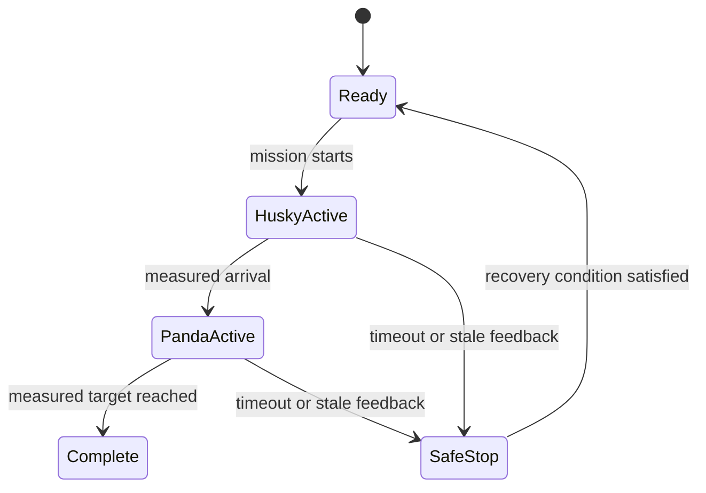

# Optional project README template

This is a suggested structure for recording a project. Copy it if it is useful,
then adapt or remove sections to fit the team's task. The course requirements
are listed in [Sessions 4–6](../../docs/projects/README.md); this file is not a
mandatory form.

## Task and environment

**Selected task brief:**

**One-sentence mission:**

**Team SDF file:**

| Robot instance | Model | Start pose/frame |
| --- | --- | --- |
| Husky | | |
| Panda | | |

List the environment geometry and note which parts are fixed, visual-only, or
used for collision. Record any simplifications.

## ROS interfaces

| Topic | Type | Units/frame | Publisher | Subscriber | Purpose |
| --- | --- | --- | --- | --- | --- |
| `/husky_runner/cmd_vel` | `geometry_msgs/msg/Twist` | m/s, rad/s | | | |
| `/husky_runner/odom` | `nav_msgs/msg/Odometry` | m, rad; world/base_link | | | |
| `/panda_inspector/joint_trajectory` | `trajectory_msgs/msg/JointTrajectory` | rad | | | |
| `/panda_inspector/joint_states` | `sensor_msgs/msg/JointState` | rad, m | | | |

Add the mission-state or diagnostic topics that the team actually needs.

## Mission state machine

Replace these example states and transitions with the team's actual mission.
Write down the measured condition, timeout, and safe action for each transition.

## Team contributions

| Student | Contribution | How it was checked |
| --- | --- | --- |
| | | |
| | | |
| | | |

The table is optional. The team should still agree on a specific technical
contribution for each member and keep enough evidence to explain and reproduce
the result.

## Success criteria and trials

| Measure | Threshold | Observed result |
| --- | --- | --- |
| Husky route/arrival | | |
| Panda target tracking | | |
| Multi-robot coordination | | |

| Trial | Task result | Measures | Pass? |
| --- | --- | --- | --- |
| 1 | | | |
| 2 | | | |
| 3 | | | |

Include at least three repeatable trials and one deliberate timeout or recovery
test, plus a graph screenshot and a compact plot or result table.

## Reproduction and limits

Record the exact build and launch commands. State which code is provided by the
course and which code belongs to the team. Do not claim perception, grasping,
physical charging, or collision avoidance unless it was implemented and tested.
