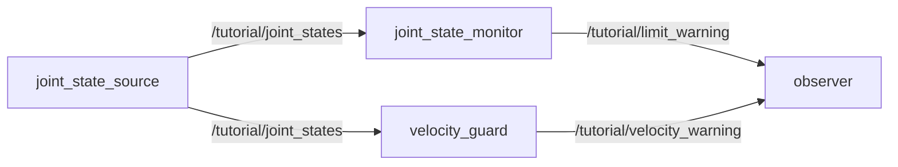

# Session 1 exercises

Session 1 contains two programming exercises. Part A completes a small
subscriber. Part B combines a publisher, subscriber, parameters and a state
machine to create a complete Panda behavior.

## Part A: velocity guard

This exercise completes the publisher/subscriber pipeline developed in
[Session 1](../../docs/session_1_ros2/README.md). You will add a node that
detects excessive joint velocity without modifying the feedback publisher.

## Required graph



## Functional requirements

Your `velocity_guard` node must:

1. subscribe to `sensor_msgs/msg/JointState` on
   `/tutorial/joint_states`;
2. publish `std_msgs/msg/Bool` on `/tutorial/velocity_warning`;
3. declare a string parameter `joint_name`, with default
   `tutorial_joint`;
4. declare a positive double parameter `velocity_limit`, with default
   `0.5` rad/s;
5. reject messages whose `name` and `velocity` arrays have different lengths;
6. select the velocity by joint name rather than assuming an array index;
7. ignore missing and non-finite joint data;
8. publish `true` exactly when
   `abs(velocity) >= velocity_limit`;
9. be installed as the executable `velocity_guard`;
10. start as part of `session1_joint_pipeline.launch.py` with parameters from
    `config/session1.yaml`.

Start from [velocity_guard_template.py](velocity_guard_template.py). Copy the
template into the package as explained in the main tutorial and replace every
`TODO`.

## Verification

Build and source after modifying `setup.py`, the launch file or the YAML file:

```bash
cd ~/git/Robotics-II/ros2_ws
colcon build --symlink-install --packages-select robotics_ii_tutorials
source ../scripts/setup_workspace.bash
```

Start the graph:

```bash
ros2 launch robotics_ii_tutorials session1_joint_pipeline.launch.py
```

Inspect it from another sourced terminal:

```bash
ros2 node info --no-daemon /velocity_guard
ros2 topic info --no-daemon /tutorial/velocity_warning --verbose
ros2 topic echo --no-daemon /tutorial/velocity_warning
ros2 param get /velocity_guard velocity_limit
```

The Boolean output must contain both `true` and `false` with the default
settings. Stop `ros2 topic echo --no-daemon` with `Ctrl+C`.

## Reasoning check

For

$$
q(t)=A\sin(2\pi f t),
$$

the maximum velocity magnitude is

$$
|\dot q|_{\max}=2\pi fA.
$$

Run the graph with two different source frequencies. Before each run, predict
whether the default velocity limit will be exceeded and then compare the
prediction with the observed Boolean output.

## Evidence to keep

- your completed `velocity_guard.py`;
- the new `setup.py` entry point;
- the launch and YAML changes;
- `ros2 node info --no-daemon /velocity_guard`;
- one `true` and one `false` output sample;
- your calculation and short explanation for both tested frequencies.

## Part B: Panda waypoint sequencer

Create one ROS 2 node that commands two Panda arm targets and decides when to
advance using measured feedback. This is the capstone exercise: the result must
be an autonomous sequence, not a list of terminal commands.

### 1. Copy the supplied starters

From the repository root:

```bash
cp exercises/session_1/panda_waypoint_sequencer_template.py \
  ros2_ws/src/robotics_ii_tutorials/robotics_ii_tutorials/panda_waypoint_sequencer.py

cp exercises/session_1/session1_panda_sequence.launch.py \
  ros2_ws/src/robotics_ii_tutorials/launch/

cp exercises/session_1/panda_sequence.yaml \
  ros2_ws/src/robotics_ii_tutorials/config/
```

Complete all six `TODO` blocks in `panda_waypoint_sequencer.py`. Do not modify
the Drake simulator to solve this exercise.

### 2. Required ROS contract

| Direction | Topic | Message type | Role |
| --- | --- | --- | --- |
| Output | `/panda/joint_trajectory` | `trajectory_msgs/msg/JointTrajectory` | Current seven-arm-joint target |
| Input | `/sim_sys/joint_states` | `sensor_msgs/msg/JointState` | Complete measured arm-and-finger state |

The command must contain `panda_joint1` through `panda_joint7` exactly once.
The feedback also contains the finger joints. Select the seven arm positions by
name with `named_positions`; do not assume that the first seven array entries
always have the required order.

### 3. Required parameters

Read these values from the supplied `panda_sequence.yaml`:

| Parameter | Requirement |
| --- | --- |
| `first_target` | Seven finite positions inside the Panda arm limits |
| `second_target` | Seven finite positions inside the Panda arm limits |
| `goal_tolerance` | Positive maximum absolute error in radians |
| `hold_time` | Non-negative time continuously inside tolerance |
| `command_period` | Positive period for repeated target publication |

Both targets must be validated with `validate_panda_target` before any command
is published.

### 4. Required behavior

Your node must:

1. start with `first_target` active;
2. publish the active target repeatedly as one `JointTrajectoryPoint`;
3. ignore malformed or incomplete feedback;
4. calculate
   $e_{\max}=\max_i|q_{d,i}-q_i|$ from the seven named arm joints;
5. start measuring the hold duration when $e_{\max}$ first enters tolerance;
6. reset that duration if the error leaves tolerance;
7. select and immediately publish `second_target` after the first target has
   remained inside tolerance for `hold_time`;
8. print `SEQUENCE COMPLETE` only after the second target has also remained
   inside tolerance for `hold_time`;
9. stop changing targets after completion.

Do not use `time.sleep()`: it blocks callback processing and cannot prove that
the robot reached a target. Use the node clock and feedback callback.

Reuse the patterns already studied instead of guessing the ROS API:

- `panda_joint_commander.py` shows how to construct and publish a
  `JointTrajectory`;
- `panda_goal_monitor.py` shows how to subscribe to `JointState`, select values
  by name and calculate the maximum error;
- `joint_state_source.py` shows how to create a timer;
- the template already declares and validates the five parameters.

The three missing ROS endpoints follow the same syntax used earlier:

```python
self.create_publisher(MessageType, "topic/name", 10)
self.create_subscription(MessageType, "topic/name", callback, 10)
self.create_timer(period_in_seconds, callback)
```

Store the returned publisher, subscription and timer as attributes of the node.
If they are only temporary local variables, Python may destroy them.

Use this pseudocode for the feedback state transition:

```text
if max_error is outside tolerance:
    forget when the hold started
else if the hold has not started:
    remember the current time
else if the hold duration has elapsed:
    advance to target 2, or finish when already at target 2
```

The first in-tolerance sample starts the hold; it does not immediately complete
the waypoint.

### 5. Register the executable

Add this line to `console_scripts` in `setup.py`:

```python
"panda_waypoint_sequencer = robotics_ii_tutorials.panda_waypoint_sequencer:main",
```

Build and source:

```bash
cd ~/git/Robotics-II/ros2_ws
colcon build --symlink-install --packages-select robotics_ii_tutorials
source ../scripts/setup_workspace.bash
```

### 6. Acceptance tests

Launch the sequence:

```bash
ros2 launch robotics_ii_tutorials session1_panda_sequence.launch.py
```

The exercise passes only if all these observations are true:

- RViz shows two distinct arm movements;
- the terminal reports the transition to waypoint 2 and then
  `SEQUENCE COMPLETE`;
- `ros2 node info --no-daemon /panda_waypoint_sequencer` shows one command publisher and
  one feedback subscriber;
- changing `hold_time` from `1.0` to `3.0` visibly delays the transition;
- an invalid `second_target` is rejected before the sequence begins;
- the sequencer still works when `JointState` contains the two additional
  finger joints.

### 7. Evidence to keep

- the completed Python node and its `setup.py` entry;
- the launch and YAML files;
- an `rqt_graph` screenshot showing both communication directions;
- the two different `JointTrajectory` targets;
- the waypoint transition and `SEQUENCE COMPLETE` logs;
- a short explanation of the error calculation, hold-time reset and invalid
  target test.
