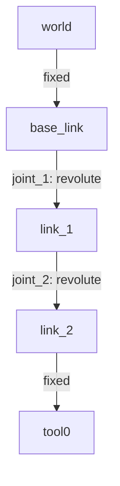

# Session 2 exercise - complete and diagnose a robot description
Begin from `tutorial_robot_student.urdf` and produce a working `my_robot.urdf`.

This exercise is intentionally incremental. After every structural edit, validate the file and relaunch. The goal is to learn how to localize model errors quickly, not to paste a full solution at once.

## Files
Create your working file:

```bash
cp ~/git/Robotics-II/ros2_ws/src/robotics_ii_description/urdf/tutorial_robot_student.urdf \
   ~/git/Robotics-II/exercises/session_2/my_robot.urdf
```

Optional but recommended: keep notes in the observation log:

```text
~/git/Robotics-II/exercises/session_2/session2_observation_log.md
```

## Target model
Your final model must have this tree:



## Model requirements
- Add `link_2`, connected to `link_1` by a revolute `joint_2`.
- Make the `joint_2` axis different from the `joint_1` axis.
- Give `joint_2` finite lower, upper, effort and velocity limits.
- Add a `tool0` frame at the end using a fixed joint.
- Give both moving physical links visual, collision and inertial elements.
- Use collision geometry no more complex than the visual geometry.
- Keep visual, collision and inertial origins consistent for each physical link.
- Keep the kinematic graph a single connected tree.

During the visual inspection, use the **RobotModel** properties in RViz2 when
available: compare **Visual Enabled** with **Collision Enabled**, and inspect
**Mass Properties** if your build provides those overlays. These properties
are attached to a link; they do not create extra TF frames.

## Step 1 - Add the second physical link
Add `link_2` after `joint_1`. Start with only the visual geometry:

```xml
<link name="link_2">
  <visual>
    <origin xyz="0.18 0 0" rpy="0 0 0"/>
    <geometry><box size="0.36 0.065 0.065"/></geometry>
    <material name="student_orange"/>
  </visual>
</link>
```

You will need to define `student_orange` near the top of the file:

```xml
<material name="student_orange">
  <color rgba="0.95 0.35 0.05 1.0"/>
</material>
```

Validate XML:

```bash
xmllint --noout ~/git/Robotics-II/exercises/session_2/my_robot.urdf
```

At this stage `link_2` is not connected yet. It should not be trusted as a robot tree until the joint is added.

## Step 2 - Connect it with `joint_2`
Add a revolute joint from `link_1` to `link_2`:

```xml
<joint name="joint_2" type="revolute">
  <parent link="link_1"/>
  <child link="link_2"/>
  <origin xyz="0 0 0.40" rpy="0 0 0"/>
  <axis xyz="0 1 0"/>
  <limit lower="-1.57" upper="1.57" effort="10.0" velocity="1.5"/>
</joint>
```

Validate:

```bash
check_urdf ~/git/Robotics-II/exercises/session_2/my_robot.urdf
```

Launch:

```bash
ros2 launch robotics_ii_description tutorial_robot.launch.py \
  model:=$HOME/git/Robotics-II/exercises/session_2/my_robot.urdf
```

Expected behavior:

| Check | Expected result |
| --- | --- |
| Slider list | `joint_1` and `joint_2` are present. |
| Move `joint_1` | The whole arm rotates around the base. |
| Move `joint_2` | Only `link_2` moves relative to `link_1`. |

Stop the launch before editing again.

## Step 3 - Add collision geometry
Add a collision element to `link_2` with the same size and origin as the visual box:

```xml
<collision>
  <origin xyz="0.18 0 0" rpy="0 0 0"/>
  <geometry><box size="0.36 0.065 0.065"/></geometry>
</collision>
```

Why this matters: RViz mainly shows visuals, but simulators and planners use collision geometry for contact and distance.

Validate again:

```bash
xmllint --noout ~/git/Robotics-II/exercises/session_2/my_robot.urdf
```

```bash
check_urdf ~/git/Robotics-II/exercises/session_2/my_robot.urdf
```

## Step 4 - Add inertial data
Add inertial data to `link_2`:

```xml
<inertial>
  <origin xyz="0.18 0 0" rpy="0 0 0"/>
  <mass value="0.6"/>
  <inertia ixx="0.0004" ixy="0.0" ixz="0.0"
           iyy="0.0067" iyz="0.0" izz="0.0067"/>
</inertial>
```

The exact numbers are less important here than the habit:

- the mass is positive;
- the inertial origin is at the center of mass;
- the inertia values are positive and plausible for a slender box;
- the visual, collision and inertial elements describe the same physical body.

## Step 5 - Add the `tool0` frame
Add a frame at the end of `link_2`:

```xml
<link name="tool0">
  <visual>
    <geometry><sphere radius="0.045"/></geometry>
    <material name="student_grey"/>
  </visual>
</link>

<joint name="tool_joint" type="fixed">
  <parent link="link_2"/>
  <child link="tool0"/>
  <origin xyz="0.36 0 0" rpy="0 0 0"/>
</joint>
```

You will also need a grey material:

```xml
<material name="student_grey">
  <color rgba="0.75 0.75 0.75 1.0"/>
</material>
```

The `tool0` link is a marker frame for inspection and future end-effector reasoning. It is not a moving physical arm link.

## Step 6 - Required checks
Run all checks:

```bash
xmllint --noout ~/git/Robotics-II/exercises/session_2/my_robot.urdf
```

```bash
check_urdf ~/git/Robotics-II/exercises/session_2/my_robot.urdf
```

```bash
ros2 launch robotics_ii_description tutorial_robot.launch.py \
  model:=$HOME/git/Robotics-II/exercises/session_2/my_robot.urdf
```

With the launch still running, use another terminal:

```bash
ros2 topic echo --no-daemon /joint_states --once
```

```bash
ros2 run tf2_ros tf2_echo world tool0
```

```bash
cd ~/git/Robotics-II/exercises/session_2
```

```bash
ros2 run tf2_tools view_frames
```

Keep `frames.pdf`.

## Diagnosis challenge
After the correct model works, make temporary copies and introduce each fault separately. Do not break your valid `my_robot.urdf`.

```bash
cp ~/git/Robotics-II/exercises/session_2/my_robot.urdf /tmp/session2_fault.urdf
```

Faults to test:

| Fault | Example change | What should detect it? |
| --- | --- | --- |
| Misspelled child link | `link_2` -> `link_two` in one joint. | `check_urdf` or missing TF branch. |
| Wrong RViz Fixed Frame | Set Fixed Frame to `map`. | RViz status panel. |
| Wrong visual origin only | Change `link_2` visual origin to `0 0 0`. | RViz geometry looks wrong, TF still connected. |
| Wrong joint origin only | Change `joint_2` origin to `0.10 0 0.40`. | `tf2_echo` and downstream frames change. |

Record:

- which tool detected the problem first;
- whether XML validation detected it;
- whether URDF validation detected it;
- whether RViz detected it;
- the difference between the visual-origin and joint-origin faults.

Delete temporary broken copies after documenting the evidence.

## Joint table
Complete this table for your final model:

| Joint | Parent | Child | Type | Origin | Axis/limit |
| --- | --- | --- | --- | --- | --- |
| `world_to_base` | | | | | |
| `joint_1` | | | | | |
| `joint_2` | | | | | |
| `tool_joint` | | | | | |

## Exit evidence
Submit or keep:

- valid `my_robot.urdf`;
- completed joint table;
- RViz screenshot in zero configuration;
- RViz screenshot in nonzero configuration;
- `frames.pdf`;
- one `tf2_echo world tool0` measurement;
- four-item diagnosis record;
- one short note about the RViz2 visual/collision/mass-properties comparison;
- short explanation of why visual origins and joint origins are different.
